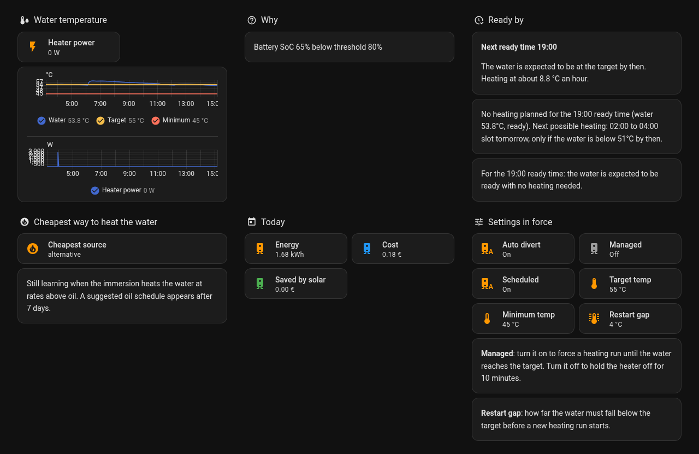

# Dashboard

The integration builds a Lovelace dashboard for you, filled in with your real entity IDs. It is a Home Assistant **dashboard strategy**, so it builds itself each time you open it, from your entity registry, your options and your Lovelace resources. Nothing is written to a file, and there is no step to repeat when something changes.

## Add the dashboard

1. Go to **Settings → Dashboards → Add dashboard**.
2. Under **Community dashboards**, pick **GivEnergy**.
3. Keep the suggested title and icon, or change them, and add the dashboard.

When the integration is first set up, a notification says the same. The integration cannot create the dashboard for you, because Home Assistant gives an integration no supported way to do it. Adding it takes one pick, and the dashboard is yours: rename it, hide it or delete it as you like. The integration never adds it again.

If **GivEnergy** is not listed, reload the browser tab so the frontend loads the integration's strategy file, then try again. A page opened in the first minutes after a restart, or on a phone app that keeps no cache, can miss the file because Home Assistant allows it only 5 seconds. A refresh or two fixes it. See [the timeout error](troubleshooting.md#the-dashboard-is-missing-or-shows-an-error). If it is still missing, add a new dashboard from scratch, open it, then the three-dot menu, **Edit dashboard**, then the three-dot menu again and **Raw configuration editor**. Use this as the whole configuration:

```yaml
strategy:
  type: custom:givenergy-manager
```

How it works: the integration serves a small JavaScript file at `/givenergy_inverter_manager/givenergy-manager-strategy.js` and adds it to the frontend as a module. The file asks Home Assistant for the dashboard over a websocket command, `givenergy_inverter_manager/dashboard`. The server builds it for the person who is signed in.

- The strategy needs a loaded config entry. Without one the dashboard shows a short message that the integration is not loaded.
- Reload the browser tab after you first set up or upgrade the integration, so the frontend loads the file.

## Moving from the generated file

Versions before 0.18 wrote `givenergy_dashboard.yaml` to the configuration folder. The Refresh Dashboard button and the `get_dashboard_yaml` action wrote it again on request. Both are gone, and so is the file the integration used to create.

1. Add the dashboard as above.
2. Delete the old dashboard, and `givenergy_dashboard.yaml` if it is still in the configuration folder. The integration no longer reads or writes it.
3. Remove any automation or script that calls `givenergy_inverter_manager.get_dashboard_yaml`. The call now fails.

A dashboard from the file keeps showing what it showed, but it no longer follows your devices or your tariff.

## What changes on its own

The dashboard is built when the page opens. A reload of the page is enough after you:

- change the tariff, or schedule a rate change
- enable or rename a sensor
- install or remove a HACS card
- add or remove an EV charger, an immersion switch or an immersion temperature sensor
- promote or demote a Home Assistant user

## What is left out

The dashboard only contains tiles and cards that will show a value.

- A tile is left out when its entity is disabled or not registered. Many sensors are disabled by default. Enable them in **Settings → Devices & services → Entities**, then reload the page.
- A section with no tiles left is left out too, so there is never a heading on its own.
- EV tiles and the EV charger sub-view need an EV charger the integration has discovered. They are hidden until it has, and shown when it does. See [Devices you add or remove later](#devices-you-add-or-remove-later).
- The heater tiles, the heater chart and the divert reason need an immersion switch. The water temperature tile and chart need an immersion temperature sensor. The Scheduled heat tile, the Ready by section, and the Heat to, Never below and Restart drop tiles and controls need both, because they act on nothing without a sensor to read.
- Inverter temperature tiles need an inverter temperature entity: the one stored at setup, or GivTCP's `sensor.givtcp_<serial>_invertor_temperature` when it exists.
- The forecast tiles need a forecast entity in the options.

## Devices you add or remove later

The EV charger, the immersion switch, the immersion temperature sensor and alternative water heating are optional, and you can add or remove any of them at any time. The dashboard follows, with no step from you.

- **A card for a device is hidden until the device exists.** Each card, tile, chart and section that needs a device carries a Lovelace visibility condition on one entity of that device. The condition hides the card while the entity is missing or unavailable. It shows the card as soon as the entity exists, and hides it again when the entity goes.
- **The cards wait for the device.** Without a device, they point at the entity IDs Home Assistant will give the device's entities, which follow from the entity names. When the device arrives, the cards show. This also keeps a copy of the dashboard working, if you [keep your own copy](#keep-your-own-copy).
- **The power flow card and the cost chart are built once for each combination of devices** and the condition shows the one that matches, as a card cannot hide a single row.
- **The Immersion and EV charger sub-views are always there.** They have no tab, and nothing opens them while their tiles are hidden.

What each device brings:

| Device | How the integration knows | Shown when it is there |
|---|---|---|
| EV charger | Discovery finds a supported charger. This runs again every five minutes until one is found | Car charger on the flow card, the EV charger tile and sub-view, EV energy and cost tiles |
| Immersion switch | The switch is set under Configure, Immersion heater (or at setup) | Heater power, energy, cost and savings, the heater chart, the divert reason, the Use spare solar and Heat now settings, the immersion node on the flow card |
| Immersion temperature sensor | The sensor is set under Configure, Immersion heater (or at setup) | The Immersion tile with the water temperature, the water temperature chart |
| Switch and sensor together | Both are set | The Scheduled heat tile and toggle, the Ready by section (while scheduled heating is on), the Heat to, Never below and Restart drop tiles and controls, and the target and minimum lines on the chart |
| Alternative water heating with the switch | Alternative water heating is on under Configure with a cost or a cost sensor set, and an immersion switch is set | The Cheapest way to heat the water section of the Immersion view (the cheapest source, the schedule line and, while Immersion Scheduled Heating is off, the live suggestion), and the advice sentence in the Ready by section |

With only a switch, the Immersion tile shows the heater power and the sub-view has a small chart of the heater's power. With only a sensor, it shows the water temperature and nothing about a heater. With both, the water temperature chart also draws the heater's power, and a tile above it shows the power now.

The integration creates the entities of a device only while the device exists. See [Sensors](sensors.md). So the sensor the dashboard hides on is not a dead entity. It is the entity that arrives with the device. The water temperature sensor mirrors the sensor you set, so the dashboard has a stable entity to chart.

## Keep your own copy

The strategy dashboard always has the layout the integration gives it. To change the layout, open the dashboard's three-dot menu, then **Edit dashboard**, and use **Take control** when Home Assistant offers it. That turns the dashboard into ordinary cards you can edit. The copy holds the dashboard as it was built for the person who took control, at that moment:

- A device that comes or goes still shows or hides its cards, because the visibility conditions are in the copy.
- A tariff change, a renamed entity, a sensor you enable later and a new HACS card do not reach the copy. Its tables read the options they were built from.
- A copy made by an administrator keeps the Settings view and a list of the administrators who may see it. Other users do not see the view, even though it is in the copy.

If Home Assistant does not offer Take control for this dashboard, build your own dashboard from the cards you want. The sections of this page name what each view holds.

### Adding a Distribution card

Home Assistant's Distribution card accepts this integration's power sensors. It draws one bar from the positive values and greys out zero and negative ones, such as a grid sensor that is exporting. It shows each entry's share of the total, so chart things on one side of the flow together. Use the consumers (**House Load**, **Immersion Heater Power**, **EV Charging Power**) or the sources, not both. Mixing solar and house load counts the same energy twice.

## HACS cards

The dashboard needs no custom card. It is built from the cards that come with Home Assistant.

| Card | Needed for | Behaviour without it |
|---|---|---|
| [power-flow-card-plus](https://github.com/flixlix/power-flow-card-plus) | The live flow card on the Now tab | An entities card lists the same values |

The integration reads the Lovelace resource list (**Settings → Dashboards → Resources**) each time the dashboard builds. The card is used only when its URL is in the list. When the list cannot be read, or the card is not in it, the entities card is used.

A card loaded some other way, for example by another integration, does not appear in the resource list. Add it as a resource, or the dashboard will use the entities card.

apexcharts-card is optional. When it is in the resource list, the immersion chart is one chart with the heater shaded behind the water temperature while it is on, as earlier versions drew it. Without it the chart is a built-in history graph. The charts on the Today and Plan & bill tabs never use it.

## Layout

The values in the screenshots are from a working install and will differ on yours.

Every view is a Home Assistant **sections** view of at most three columns. Each section is a group of cards that starts with a heading. The number of columns follows the screen: one on a phone, two on a tablet, three on a laptop or wider. Some sections are wider than one column:

- The live power flow is two columns wide, beside Now.
- The banners, the hour by hour chart and the 31 day bill chart run across the whole view.

A wide section narrows to the columns the screen has, so on a phone everything stacks in one column. The sections are placed densely: a section that fits a gap left by a wider one moves up into it, which is how the power flow stays beside Now while a banner follows Now.

Tiles are the main building block. They are horizontal, two to a row in a one-column section (a tile with a switch takes the whole row), and use colour the same way everywhere: amber for solar, green for the battery and savings, blue for the grid and money, orange for the immersion, teal for the EV charger and indigo for the night.

The controls use tile features: − and + buttons on the number entities, so a value such as 45 °C or 25% is easy to set exactly, and a toggle on the switches. They sit in the Settings sub-view, which only administrators see. Everywhere else a tile shows a setting's value and does nothing when tapped. Charts take the full width of their section.

The dashboard has three tabs: **Now**, **Today** and **Plan & bill**. The detail of each tab sits lower on the same tab, so only four things open a sub-view: the Immersion and EV charger tiles under Devices on Now, the Settings button in the Now heading (administrators only), and the Tariff button in the Bill heading on Plan & bill. The back arrow at the top of a sub-view returns to the tab that opened it. A heading or tile that opens another tab or view shows a chevron or opens it when tapped.

The Immersion and EV charger sub-views are always built so a device added later has somewhere to show, and their tiles are hidden until the device exists.

A rate tile says per kWh in its name (Rate per kWh, Avg import/kWh). The rate sensors report a bare currency amount, and their unit stays that so long-term statistics are not affected.

The links use relative paths, so they work at any dashboard URL. The Now tab keeps the path `power-flow` it had as the Power Flow tab, so a saved link still opens it.

### Settings and administrators

Everything that changes a setting is in the **Settings** sub-view. A small **Settings** button in the Now heading of the Now tab opens it. Both are for Home Assistant administrators only. Everyone else sees neither, and the rest of the dashboard only shows state.

Home Assistant has no admin option for a dashboard. A view takes a list of users in `visible`, and a card or heading button takes a user condition. The integration uses both, and the server's own check on top.

- **The server decides.** Home Assistant tells the integration whether the person who opened the dashboard is an administrator. A person who is not one is sent a dashboard with no Settings view and no button, so there is nothing for the browser to hide. The request carries no flag the browser could set, and a request with extra fields is refused.
- **A list of administrators stays in the view.** For an administrator, the Settings view and the button also carry the list of administrators, as a visibility condition. A copy made with [Take control](#keep-your-own-copy) still hides Settings from other users.
- **Administrator roles change.** The dashboard asks again each time it opens, so a reload of the page is enough after you promote or demote a user.
- **No administrator found.** The Settings view and its button are left out for everyone. Home Assistant always has at least one administrator, so this only happens when the user list could not be read.

This hides the controls. It is not security. Home Assistant has no permissions for single entities, so a user who is not an administrator can still change the switches and numbers from the entity page, the Entities list, another dashboard, an automation or the API. The server sends a person who is not an administrator no Settings view, but a copy made with Take control holds it and Home Assistant only hides it from them. Use it to keep a shared wall tablet or a family dashboard tidy, not to protect the inverter.

### Now

- **Now**: Battery (state of charge, with a line of the last 24 hours), Rate per kWh, Cost today, Battery overnight and Cheap from (Next Cheap Rate Start). Cheap from is a full-width tile that reads the start and the wait in one line, such as `23:00 (in 8 h 56 min)`, or `Now (ends in 5 h 30 min)` while one is active. The end is where the run of cheaper-than-base periods stops, so a cheaper period inside a longer one does not cut it short. Battery overnight is a full-width tile that says whether the battery lasts until solar starts, and the charge expected at sunrise, such as `Lasts the night · 36% at sunrise`. The other phrases are `Only just lasts the night` and `May run low`. While tonight's planned charge counts, the tile gives both figures (`Lasts the night · 36% at sunrise without a charge, about 89% with tonight's charge`), and a tight or short night says whether the charge covers it (`May run low without a charge · tonight's charge covers it, about 67% at sunrise`, or `May run low, even with tonight's charge · about 13% at sunrise`). A long line is cut to the width of the tile, and the Plan & bill tab has the whole sentence. It reads the Battery Overnight Confidence sensor, which is disabled by default, so a new install shows four of the five until you enable it. The sensor's state stays Safe, Warning or Critical. Tap the Battery or Battery overnight tile to open Plan & bill. For administrators the heading also holds a **Settings** button, and the section ends with Home Assistant's **Repairs** card, which hides itself while there are none. It lists every repair in Home Assistant, not only this integration's, because the card has no filter.
- **Dry run is on**: a banner with the last skipped action and tonight's charge plan, so you can see what the integration would do next. The plan is the Tonight's charge plan sensor, which Plan & bill also shows. The banner appears only while Dry Run Mode Active is true. It says how to go live: an administrator turns off the Dry run switch in Settings. On a test instance, where a `.givenergy_test_instance` file forces dry run on, it says so and names the file to delete instead.
- **Something else is setting your charge target**: a banner while Charge Target Conflict reads `suspected`.
- **Finish setting up**: a banner while Setup Progress reads incomplete.
- **Live power flow**: a power-flow-card-plus card with solar, battery, grid, home and, when they exist, two individual loads: the EV charger and the immersion. Solar shows a clipping marker. The battery node reads Battery Power for the flow and Battery State of Charge for the percentage. Battery Power is positive while charging and the card expects the opposite, so the node sets `invert_state: true`. The grid node shows the Live Grid Cost Rate with the unit of your currency symbol per hour, for example `0.0412 €/h`. The rate is what the current grid flow costs each hour, negative while you earn from export.
- **Today so far**: Solar, Solar forecast and Of forecast (with a forecast sensor set), Home used (House Load Today), Imported, Exported and Self-sufficient. Solar forecast is the provider's own figure for today and Of forecast is the solar generated so far against it. Self-sufficient is the share of what the house used that did not come from the grid. Tap the heading to open the Today tab.
- **Devices**: an Immersion tile (the water temperature, or the heater power when there is no sensor) and an EV charger tile (the charger state). Each opens its sub-view. The heading and each tile show only while their device exists.

The banners sit under Now in the list, so on a phone they come straight after it. On a laptop the power flow moves up beside Now and the banners run across the view below them.

For the EV load, the dashboard uses the first of these entities that exists, else the integration's own EV Charging Power: `sensor.myenergi_zappi_power_ct_internal_load`, `..._2`, `sensor.myenergi_zappi2_power_ct_internal_load`, `sensor.wallbox_charging_power`, `sensor.ohme_current_power`.

### Immersion (sub-view)



Each section shows only while the device it needs exists.

- **Water temperature** (needs the sensor): a 12-hour chart of water temperature. With a switch as well, it also draws the target and minimum and when the heater was on, and a **Heater power** tile above it shows the power now. With apexcharts-card installed it is one chart with the on times shaded. Without it, it is a history graph with the heater's power as a second chart under the temperatures. The heater's power is a fixed number, so it reads as 0 while the heater is off and your heater's wattage while it is on.
- **Heater on or off** (needs the switch and no sensor): the Heater power tile and a small 12-hour history graph of the heater's power, for an install with a switch but no temperature sensor. It hides itself when a sensor is set, as the water temperature section then carries the heater.
- **Why** (needs the switch): the divert reason in words.
- **Ready by** (needs the switch and the sensor, and shows only while Immersion Scheduled Heating is on): the next hot water ready time, whether the water is expected to be at the target by then, and the heating rate the plan uses. It reads the `ready_by`, `expected_ready` and `heating_rate_c_per_h` attributes of the Immersion Water Temperature sensor, so there is no helper sensor. Below it a line from the `planned_heating` attribute says what the immersion plans, for example `Heating planned for the 19:00 ready time: 17:10 to 18:30 at the Day rate.` or `No heating planned for the 19:00 ready time (water 54.4°C, ready). Next possible heating: 02:00 to 04:00 slot, only if the water is below 51°C by then.` With no water reading yet it says the plan shows once the temperature is read. See [Scheduled immersion heating](concepts.md#scheduled-immersion-heating). With alternative water heating set it adds the advice sentence below it, which says when to start the alternative for that ready time, for example `For the 19:00 ready time: turn the oil water heating on at 16:30 (about 90 minutes). The immersion will only top up.` It follows the advice, so it is hidden while that sensor is unavailable. The Cheapest way to heat the water section leaves the same sentence out while this section shows, so the page has one copy. Home Assistant cannot hide a card on a missing attribute, so with the switch on and no ready time set, the card says where to add one.
- **Cheapest way to heat the water** (needs alternative water heating with a cost, and the switch): a tile with the cheapest source now (electricity, solar or alternative) and the suggestion in a sentence, for example `Oil is cheaper than electricity until 23:00 (saves about 0.16 per kWh of heat). Heat the water with the oil system now.` With a water temperature sensor the sentence also says when to start the alternative for the next ready time, when to run it to keep the water warm, that the water is already at the target, or that it is expected to be ready with no heating needed. While Immersion Scheduled Heating is on, the Ready by section above prints this sentence, so this section leaves it out and shows the tile and the schedule line. It is advice only: the integration does not switch the other system. The section hides itself while the sensor has no reading, for example when a cost sensor is unavailable and no cost is saved. See [Alternative water heating advice](concepts.md#alternative-water-heating-advice). Below the suggestion is a separate line for the recurring schedule, for example `Over the last 14 days the immersion used about 14 kWh of grid electricity that cost more than oil, mostly around 13:00 and 19:00. Running the oil from 12:30 to 13:00 and 18:00 to 19:00 would have saved about 6.00 over those days.` Until the integration has seen 7 days it says it is still learning, and with 7 days or more and nothing worth suggesting it says so. The schedule is advice too, and the integration does not switch the other system. The lines name the alternative by the name you set, Oil by default.
- **Today** (needs the switch): energy, cost and what solar saved.
- **Settings in force** (needs the switch): Use spare solar (Auto Immersion Divert) and Heat now (Immersion Heater Managed), to read. With a sensor as well it adds Scheduled heat (Immersion Scheduled Heating), Heat to (the target temperature), Never below (the minimum temperature) and Restart drop (the restart gap). Change them in Settings. Under the tiles, two short lines say what Heat now and Restart drop mean: Heat now forces a heating run when turned on and holds the heater off for 10 minutes when turned off, and Restart drop is how far the water must fall below the target before a new heating run starts. The Heat now line shows with the switch, and the Restart drop line needs the sensor as well.

### EV charger (sub-view)

- **Charging now**: charger state, charge power, session energy and charging source.
- **Why**: whether the EV is draining the battery, the solar surplus available and the mode decision in words.
- **Today**: the energy the charger delivered and what it cost.
- **Charge power, last 24 hours**: a line graph of the charger's power. It uses the same power entity as the Charge power tile. Power does not reset at midnight, so a history graph draws it without a sawtooth.

The sections show only while a charger exists.

### Today


- **Today hour by hour**: stacked bars of where each hour's energy came from over the last day: Solar, From battery (Battery Discharged Today) and From grid (Grid Import Today). It runs across the whole view.
- **Energy**: Solar, Home used, Imported, Exported, EV and Immersion.
- **Where today's energy came from**: three lines in plain words, then one line for each of the EV and the immersion that exists.
  - House used: what the house used, split into solar, battery and grid. Solar and battery show as one figure when the Battery Discharged Today sensor is disabled. The integration enables it on start, unless you disabled it yourself.
  - Grid import: what came in from the grid, split into the part the house used and the part that went into the battery. The split needs the inverter's AC charge counter. Without it the card says the split is not known and counts all of the import as used by the house.
  - Self-sufficiency: the share of what the house used that did not come from the grid.
  - EV and immersion: how much of the house use went to each. They are part of the house use, not added to it. A line shows only while its device exists.

  The card reads four attributes of the Self Sufficiency sensor: `house_load_kwh`, `from_grid_kwh`, `grid_to_battery_kwh` and `basis`. Where one is missing it uses the House Load Today and Grid Import Today totals. The whole group is left out when Self Sufficiency, House Load Today or Grid Import Today is missing.
- **Cost**: Import cost and Export earnings, then today's import cost by load: Rest of house, EV charging and Immersion (the last two only while that device exists). Then Rate per kWh, Rate period and, with an immersion switch, Immersion solar saving, which is what solar saved on the immersion.
- **Solar**: Home use from solar and Solar kept at home, each with a bar. Home use from solar is the Solar Share sensor: the share of what the house used that solar supplied. Solar kept at home is the Self Consumption sensor: the share of today's solar that was not exported. Self-sufficiency has no bar here, because the card above it states the figure with what it means. The Now tab keeps its Self-sufficient tile, as the glance. The bar comes back on this tab when that card cannot be built, which happens when Self Sufficiency, House Load Today or Grid Import Today is missing, so the figure is never lost.
- **Against the forecast** (with a forecast sensor set): Generated today, Solar forecast, Of forecast, Plan forecast and Yesterday's accuracy (yesterday's solar as a share of the forecast for that day).
- **Cost per day, last 14 days**: a bar graph of Rest of house, EV charging and Immersion (the last two only while that device exists) and Export earnings, named as the Cost section names them. It does not plot the import cost, because that is the sum of the three, and drawing it beside them would count the same cost twice. Read the total from the Import cost tile.
- **Last 7 days** (with a forecast sensor set): a bar graph of what was generated on each of the last 7 days. The forecast sensor keeps no long-term statistics, so no chart plots the forecast. The Solar forecast and Yesterday's accuracy tiles carry it.

Solar forecast is what your forecast service predicted for today, as it stood just before midnight. Of forecast compares solar generated so far with that figure. Plan forecast is the figure the overnight charge calculation used: blended toward the pessimistic estimate and scaled by the accuracy correction, so it can differ from the provider's figure. The tile's sensor also says in its `solar_profile_source` attribute whether the plan spread that figure with the forecast's own shape (`forecast`) or the standard curve (`standard curve`). Judge the day against Solar forecast. A line under the tiles says the same in one sentence, and shows while the Plan forecast tile does. Solar forecast and Of forecast read empty on a new install until the first midnight, because the provider forecast is remembered then.

The graphs on the Today and Plan & bill tabs are statistics graphs, not history graphs. The daily sensors fall to zero at midnight, so a history graph of them draws a sawtooth. The graphs plot the change in each period instead, from the long-term statistics. They stay empty until Home Assistant has compiled statistics for the sensors, which takes up to an hour.

### Plan & bill

Six sections: tonight, why, the battery, the bill, the cost per day and the health of the battery and inverter.

- **Tonight's charge**: the plan in one sentence first, then Target (the target the plan would set if tonight charges, which is not a promise that it does) and Est. cost. On a skipped night the same figure is labelled **Hold at**: it is the seasonal minimum plus a 10-point buffer, written as the charge target so the inverter does not import to keep the battery higher, and it is not a charge goal. Then then Sunrise (no charge) and Sunrise (with charge), the estimated state of charge at sunrise without and with tonight's planned charge. The sentence is the Tonight's charge plan sensor, and says outright whether tonight charges (`Target 78% · Add 34% · Cost €0.51`) or is skipped (`Skip charge · Plan forecast 8.2 kWh · SoC 64%`). Below them, a tile shows each thing that changes tonight's charge, only while it does: Fixed target with its Charge to value, Skip tonight, Dry run and the cheap rate floor. Everyone can read them here, and administrators change them in Settings.
- **Battery overnight**: the outlook in bold, with no repeat of the heading, then why. Where the Battery Overnight Confidence sensor has an `explanation` attribute, that is shown, with the figure with tonight's planned charge and whether it covers the night while a charge counts. Otherwise a Warning is explained from the estimated state of charge at sunrise without a charge ("about 14% at sunrise without a charge, close to your minimum charge") and, when a charge adds something, the figure with the planned charge. Safe and Critical show the Battery Overnight Outlook text, which carries any kWh shortfall. Without the confidence sensor, which is disabled by default, only the status text is shown. The two Sunrise figures it judges are in Tonight's charge plan, so they are not repeated here. Under it, **Why this target** gives the reason for tonight's charge target. Both are sentences, and a tile cuts them off, so they sit in Markdown cards. The cards print the `full_text` attribute of the sensor when it has one and otherwise its state, because the state of a long reason is cut to 255 characters. The divert reason and the EV mode decision cards do the same.
- **Battery**: state of charge and battery power, each with a line of the last 24 hours.
- **Bill**: Accrued bill, Projected bill, Import cost, Export credit, Days left and Avg import/kWh. A **Tariff** button in the heading opens the Tariff sub-view.
- **Cost per day, last 31 days**: a bar graph of the import cost and the export credit of each day, so you can see which days made the bill. It runs across the whole view. It reaches back 31 days because a bill period is a calendar month at most. The graph cannot mark where your bill period starts, because that moves each month.
- **Health**: total cycles, life remaining, days since full charge, and with an inverter temperature entity the inverter's temperature and status.

Days Elapsed in Bill Period, Average Import Rate This Month and Cheap rate import fraction this month are disabled by default. Enable them to see those tiles.

Accrued Bill This Period is worked out line by line from the month totals: energy less the supplier saving, standing charge, PSO levy and VAT, minus the export credit. Projected Bill This Period scales it to the whole period. See [Tariff](tariff.md#bill-sensors). Import cost this month is the import energy for the period after discount and VAT. It leaves out the standing charge, the PSO levy and the export credit.

### Tariff (sub-view)


A table of the base rate and each timed rate period with its window, the rate, and the rate billed per kWh after the supplier discount and VAT. It also lists the export rate, standing charge, PSO levy and bill start day.

The table is read from your options each time the dashboard opens, so a reload of the page shows a change. It uses the same defaults as the integration for any field you have not set.

Under it, **Scheduled rate changes** lists each dated change that has not started: the date it starts, the new base rate, the timed rates with their windows, and the export rate. The line below the table gives the date the tariff was last reviewed. The list is left out when no change is scheduled, and so is the heading. A change that has started is not listed, because the table above already shows its rates. A change replaces the base rate, the timed rates and the export rate on its date, and the standing charge, levy, VAT, discount and bill start day stay as they are in the table above.

Like the table, the list is read from your options each time the dashboard opens, so a change that has started drops out of the list on the next page load. To schedule a change, see [Change the rates from a date](tariff.md#change-the-rates-from-a-date).

### Settings (sub-view, administrators only)

Three sections. The first is two rows tall, so on a tablet Fine-tuning sits under Hot water, and on a laptop the three sit side by side.

- **Dry run**: the Dry run switch. Turn it off to go live. It cannot be turned off on a test instance. Under it, **Tonight's charge**: the Fixed target switch, the Charge to number while Fixed target is on, and the Skip tonight switch. Under them, **Recent changes** lists what changed any setting on this view in the last day, from Home Assistant's logbook. It names the immersion settings only while the immersion switch exists.
- **Hot water** (needs the immersion switch): the divert reason in words first, so the controls below read against what the heater is doing now. Then Use spare solar (Auto Immersion Divert) and Heat now (Immersion Heater Managed). With a temperature sensor as well: Scheduled heat (Immersion Scheduled Heating), Heat to and Never below. A line says what Heat now does.
- **Fine-tuning**: the numbers you set once and leave. The cheap rate floor, the skip-charge threshold and forecast caution, with the immersion switch Min battery and Min surplus (the battery charge and the spare power before solar goes to the water), and with a sensor as well Restart drop. Then the Re-plan charge and Verbose logging switches, and one card with a line on each.

The view is left out when there is no administrator to show it to. The dry run banner is not here. It sits on the Now tab and appears only while Dry Run Mode Active is true.

## HTML report cards

Three sensors carry a styled HTML report in their `html` attribute: Today's energy summary, Tonight's charge plan and This week's energy summary. They use inline styles, so the built-in Markdown card renders them.

Today's energy summary and This week's energy summary are disabled by default. Enable them in the entity list first. Tonight's charge plan is enabled by default, because the Plan & bill tab reads its sentence. The `html` attribute is kept out of the recorder.

```yaml
type: markdown
content: "{{ state_attr('sensor.givenergy_inverter_manager_todays_energy_summary', 'html') }}"
```

Replace the entity ID with the real one from **Settings → Entities**.

The Solar row of Today's energy summary carries the same forecast as the dashboard: the provider's own forecast for today and the share of it generated so far, matching Solar forecast and Of forecast. The row shows no forecast until the provider's figure has been remembered at the first midnight. Tonight's charge plan shows the plan's forecast on its own row, labelled Plan forecast, because the charge calculation blends it toward the pessimistic estimate. The accuracy rows of This week's energy summary measure against the provider's forecast too.
