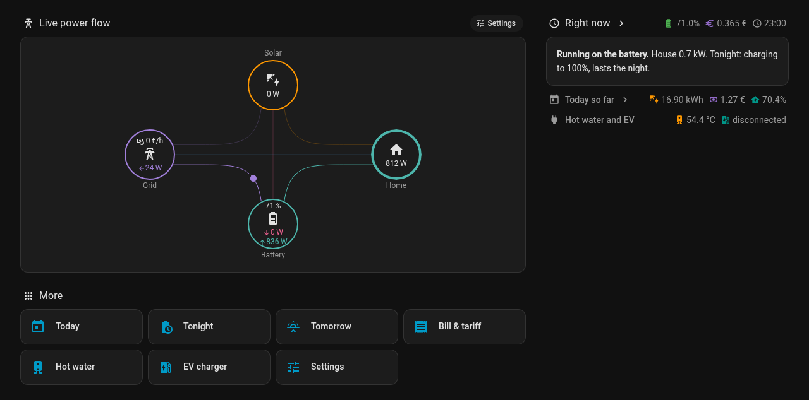
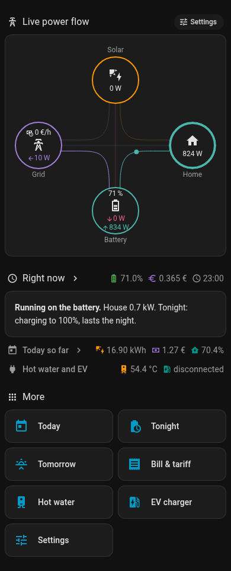
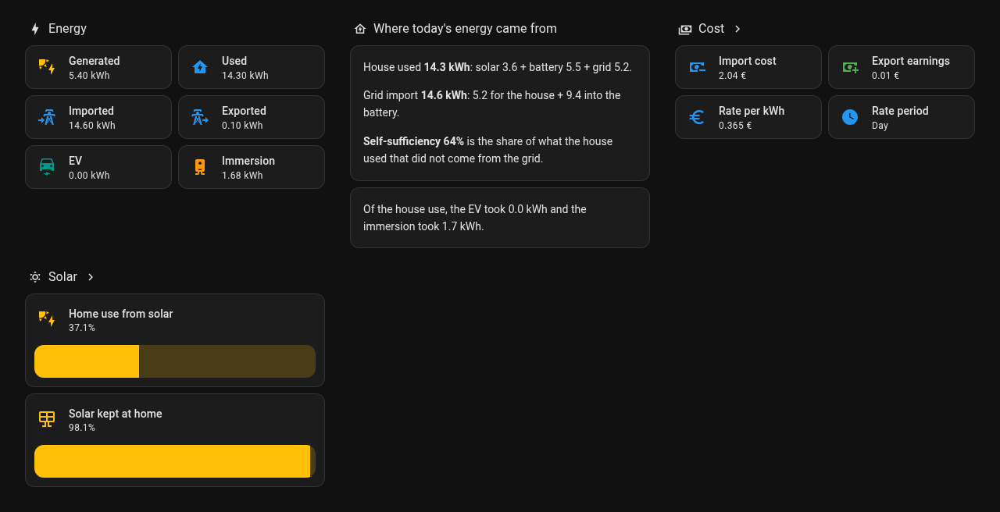
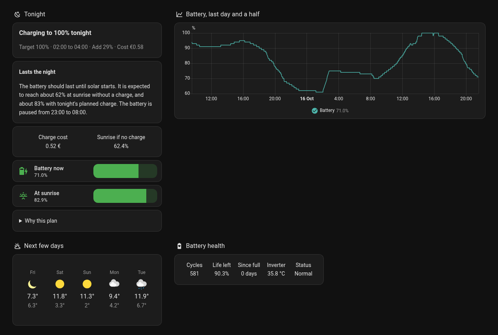
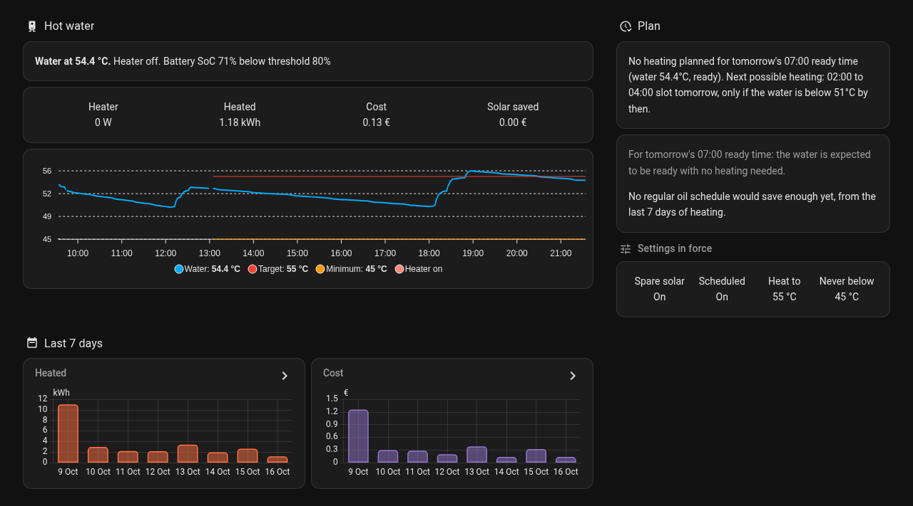
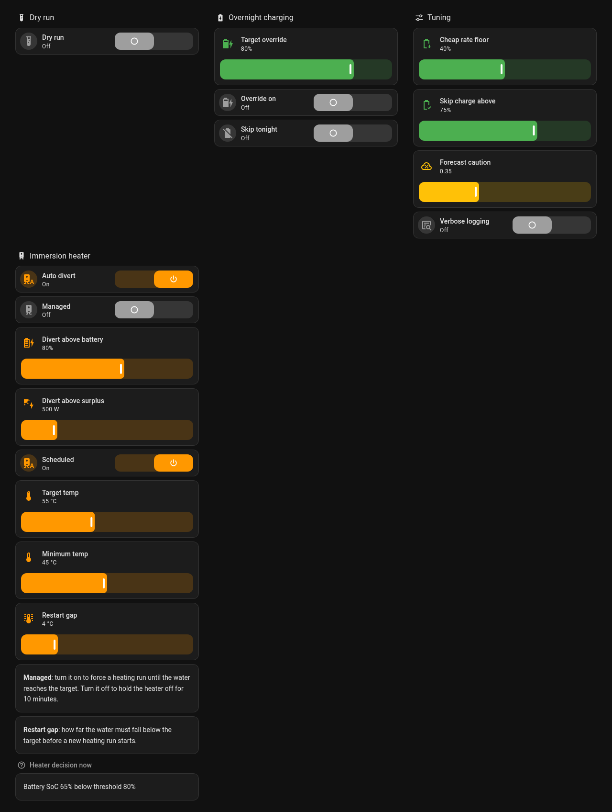

# Dashboard

The integration builds a Lovelace dashboard for you, filled in with your real entity IDs. There are two ways to get it:

- **A stored dashboard** (recommended). You make a blank dashboard and the `update_dashboard` action writes the generated layout into it. It is a plain dashboard, so it loads on any device. When the layout changes, a repair offers to update it with one click.
- **The strategy dashboard.** You pick **GivEnergy** under **Community dashboards** and it builds itself each time it opens. On some devices it shows "Timeout waiting for strategy element" instead. See [The strategy dashboard](#the-strategy-dashboard).

The integration never creates a dashboard, and it writes one only when you run the action or press **Submit** in the repair.

## Add the dashboard

1. Go to **Settings → Dashboards → Add dashboard → New dashboard from scratch**. Give it a name and an icon, and create it.
2. Open it and look at its address, such as `/dashboard-energy`. The part after the slash is its URL path.
3. Go to **Developer Tools → Actions** and choose **GivEnergy Inverter Manager: Update dashboard** (`givenergy_inverter_manager.update_dashboard`). Enter the URL path, such as `dashboard-energy`, and press **Perform action**.
4. Open the dashboard. It holds the generated layout.

When the integration is first set up, a notification says the same. Only an administrator can run the action, and the dashboard it writes has the Settings view. The view, and the Settings buttons on Home energy, are shown only to administrators. See [Actions](actions.md#update_dashboard).

The action writes into a storage dashboard: one made in **Settings → Dashboards**. It refuses a YAML dashboard, a URL path with no dashboard, and Home Assistant's recovery mode. The default **Overview** dashboard is a storage dashboard too, so you can write into it, but it then loses the cards it had.

### Keep it up to date

The integration remembers the dashboard it wrote. When that dashboard no longer matches the layout it would build now, the repair **The GivEnergy dashboard is out of date** appears in **Settings → System → Repairs**. That happens after an upgrade changes the layout, after you add or remove a device, enable a sensor or install a HACS card, after an administrator is added, and after anyone edits the dashboard.

Open the repair and press **Submit** to write the current layout. To keep the dashboard as it is, ignore the repair. The integration looks again a minute after its entities change, after you save its options, and once an hour.

If you delete the dashboard, or it is no longer a storage dashboard, the integration forgets it and the repair goes. Run the action again with another URL path to start again.

### Your own edits and the backup

The action and the repair replace the whole dashboard, your own edits included. Before each write, the dashboard's configuration is saved to `givenergy_dashboard_backup.yaml` in the configuration folder, replacing the previous backup. To get your edits back, open the dashboard's raw configuration editor and paste from the file. To keep your own layout for good, use a different dashboard and leave this one to the integration.

## The strategy dashboard

The strategy dashboard builds itself each time you open it, from your entity registry, your options and your Lovelace resources. Nothing is written to a file, and there is no step to repeat when something changes. It needs a small script to load in the browser first, and on some devices that script is not ready in the 5 seconds Home Assistant waits for it. The dashboard then shows "Timeout waiting for strategy element". If that happens to you, use [the stored dashboard](#add-the-dashboard) instead.

1. Go to **Settings → Dashboards → Add dashboard**.
2. Under **Community dashboards**, pick **GivEnergy**.
3. Keep the suggested title and icon, or change them, and add the dashboard.

Adding it takes one pick, and the dashboard is yours: rename it, hide it or delete it as you like. The integration never adds it again.

If **GivEnergy** is not listed, reload the browser tab so the frontend loads the integration's strategy file, then try again. If it is still missing, add a new dashboard from scratch, open it, then the three-dot menu, **Edit dashboard**, then the three-dot menu again and **Raw configuration editor**. Use this as the whole configuration:

```yaml
strategy:
  type: custom:givenergy-manager
```

How it works: the integration serves a small JavaScript file at `/givenergy_inverter_manager/givenergy-manager-strategy.js` and adds it to the frontend as a module. The file asks Home Assistant for the dashboard over a websocket command, `givenergy_inverter_manager/dashboard`. The server builds it for the person who is signed in.

- The strategy needs a loaded config entry. Without one the dashboard shows a short message that the integration is not loaded.
- Reload the browser tab after you first set up or upgrade the integration, so the frontend loads the file.
- A strategy dashboard is never kept up to date by the repair. It needs no update, because it builds itself.

## A fallback that needs no script

The `update_dashboard` action above is the quickest way to a dashboard that needs no script. To make the same copy by hand instead:

1. Open **Developer Tools → Actions**, choose `givenergy_inverter_manager.get_dashboard_yaml` and press **Perform action**.
2. Copy the `yaml` value from the response.
3. Go to **Settings → Dashboards → Add dashboard → New dashboard from scratch**, give it a name and open it.
4. Choose the pencil, then the three dots, then **Raw configuration editor**. Replace what is there with the YAML and save.

This copy is a plain dashboard, so it works on any device that can open a dashboard. The tariff table and the bill tables follow your tariff and your bill, because they read the **Tariff in use**, **Bill audit** and **Previous bill audit** sensors. The rest does not follow a new device, so run the action again and paste again after you add or remove one. The integration does not know about a pasted copy, so no repair says when it is out of date. The copy has a Settings view, because an administrator ran the action. The view, and the Settings buttons on Home energy, are already shown only to administrators, so leave them in place. If you delete the view, delete the buttons too, or they point nowhere. See [Actions](actions.md#get_dashboard_yaml).

### Keep it in a file instead

Pasting by hand each time is slow. To have the dashboard follow a file, set it up once and then only run the action:

1. Add this to `configuration.yaml`, then restart Home Assistant:

   ```yaml
   lovelace:
     dashboards:
       givenergy-file:
         mode: yaml
         filename: givenergy_dashboard.yaml
         title: GivEnergy
         icon: mdi:solar-power-variant
         show_in_sidebar: true
   ```

2. Run `givenergy_inverter_manager.get_dashboard_yaml` with **Write file** on. It writes `givenergy_dashboard.yaml` to the configuration folder and replaces the file each time.
3. Open **GivEnergy** in the sidebar. After a tariff or device change, run the action again and reload the page. There is nothing to paste.

A YAML dashboard cannot be edited in the dashboard editor. Change the file, or run the action again. If `givenergy_dashboard.yaml` does not exist yet, the dashboard shows an error until step 2 has run. `update_dashboard` does not write into a YAML dashboard.

## Moving from the generated file

Versions before 0.18 wrote `givenergy_dashboard.yaml` to the configuration folder. The Refresh Dashboard button wrote it again on request. The button, and the file the integration used to create, are gone. The `get_dashboard_yaml` action is back as the fallback above and returns text. It writes `givenergy_dashboard.yaml` again only when you turn on **Write file**.

1. Add the dashboard as above.
2. Delete the old dashboard, and `givenergy_dashboard.yaml` if it is still in the configuration folder. The integration no longer reads or writes it.
3. Remove any automation or script that calls `get_dashboard_yaml` without expecting it to return text. The action returns the text, and writes the file only with **Write file** on.

A dashboard from the file keeps showing what it showed, but it no longer follows your devices. Its tariff and bill tables follow your tariff and your bill.

## What changes on its own

The strategy dashboard is built when the page opens. A reload of the page is enough after you do one of the things below. A stored dashboard raises the out-of-date repair instead, and follows once you press **Submit** (see [Keep it up to date](#keep-it-up-to-date)). Its tariff and bill tables follow a change at once.

- change the tariff, or schedule a rate change
- enable or rename a sensor
- install or remove a HACS card
- add or remove an EV charger, an immersion switch or an immersion temperature sensor
- promote or demote a Home Assistant user

## What is left out

The dashboard only contains figures and cards that will show a value.

- A figure, chip or tile is left out when its entity is disabled or not registered. Many sensors are disabled by default. Enable them in **Settings → Devices & services → Entities**, then reload the page.
- A section with nothing left is left out too, so there is never a heading on its own.
- The EV chip, the EV figures and the EV charger sub-view need an EV charger the integration has discovered. They are hidden until it has, and shown when it does. See [Devices you add or remove later](#devices-you-add-or-remove-later).
- The heater figures, the heater chip, the Plan section and the divert reason need an immersion switch. The water temperature chip, sentence and chart need an immersion temperature sensor. Scheduled heating, Heat to, Never below and Restart drop need both, because they act on nothing without a sensor to read.
- The inverter temperature figures need an inverter temperature entity: the one stored at setup, or GivTCP's `sensor.givtcp_<serial>_invertor_temperature` when it exists.
- The forecast figures, and the sentence and figures at the top of the Tomorrow sub-view, need a forecast entity in the options.

## Devices you add or remove later

The EV charger, the immersion switch, the immersion temperature sensor and alternative water heating are optional, and you can add or remove any of them at any time. The dashboard follows, with no step from you.

- **A card for a device is hidden until the device exists.** Each card, tile, chart and section that needs a device carries a Lovelace visibility condition on one entity of that device. The condition hides the card while the entity is missing or unavailable. It shows the card as soon as the entity exists, and hides it again when the entity goes.
- **The cards wait for the device.** Without a device, they point at the entity IDs Home Assistant will give the device's entities, which follow from the entity names. When the device arrives, the cards show. This also keeps a copy of the dashboard working, if you [keep your own copy](#keep-your-own-copy).
- **The power flow card and the cost charts are built once for each combination of devices** and the condition shows the one that matches, as a card cannot hide a single row.
- **The Hot water and EV charger sub-views are always there.** Nothing opens them while their chips and buttons are hidden.

What each device brings:

| Device | How the integration knows | Shown when it is there |
|---|---|---|
| EV charger | Discovery finds a supported charger. This runs again every five minutes until one is found | Car charger on the flow card, the EV chip, the EV charger button and sub-view, the EV share of the cost charts |
| Immersion switch | The switch is set under Configure, Immersion heater (or at setup) | Heater power, energy, cost and savings, the heater chart, the divert reason, the Use spare solar and Heat now settings, the immersion node on the flow card |
| Immersion temperature sensor | The sensor is set under Configure, Immersion heater (or at setup) | The water temperature chip, the Hot water sentence and the water temperature chart |
| Switch and sensor together | Both are set | The planned heating (while scheduled heating is on), Scheduled, Heat to and Never below in Settings in force, the Scheduled heat, Heat to, Never below and Restart drop controls, and the target and minimum lines on the chart |
| Alternative water heating with the switch | Alternative water heating is on under Configure with a cost or a cost sensor set, and an immersion switch is set | The cheapest way to heat the water now and the schedule line, in the Plan section of the Hot water view |

With only a switch, Home energy shows the heater chip while it heats and the Hot water view gives the divert reason and the heater's figures. With only a sensor, it shows the water temperature and nothing about a heater. With both, the water temperature chart also draws the heater's power and the target and minimum.

The integration creates the entities of a device only while the device exists. See [Sensors](sensors.md). So the sensor the dashboard hides on is not a dead entity. It is the entity that arrives with the device. The water temperature sensor mirrors the sensor you set, so the dashboard has a stable entity to chart.

## Keep your own copy

The strategy dashboard always has the layout the integration gives it. To change the layout, open the dashboard's three-dot menu, then **Edit dashboard**, and use **Take control** when Home Assistant offers it. That turns the dashboard into ordinary cards you can edit. The copy holds the dashboard as it was built for the person who took control, at that moment:

- A device that comes or goes still shows or hides its cards, because the visibility conditions are in the copy.
- A tariff change, a renamed entity, a sensor you enable later and a new HACS card do not reach the copy. Its tables read the options they were built from.
- A copy made by an administrator keeps the Settings view and a list of the administrators who may see it. Other users do not see the view, even though it is in the copy.

If Home Assistant does not offer Take control for this dashboard, build your own dashboard from the cards you want. The sections of this page name what each view holds.

### Adding a Distribution card

Home Assistant's Distribution card accepts this integration's power sensors. It draws one bar from the positive values and greys out zero and negative ones, such as a grid sensor that is exporting. It shows each entry's share of the total, so chart things on one side of the flow together. Use the consumers (**House Load**, **Immersion Heater Power**, **EV Charging Power**) or the sources, not both. Mixing solar and house load counts the same energy twice.

## HACS cards

The dashboard needs no custom card. It is built from the cards that come with Home Assistant.

| Card | Needed for | Behaviour without it |
|---|---|---|
| [power-flow-card-plus](https://github.com/flixlix/power-flow-card-plus) | The live flow card on Home energy | An entities card lists the same values |
| [apexcharts-card](https://github.com/RomRider/apexcharts-card) | The water temperature chart with the heater shaded behind it, and the Solar through the day curve on Tomorrow | A history graph draws the temperatures with the heater's power as a second chart, and Tomorrow has no curve |
| [card-mod](https://github.com/thomasloven/lovelace-card-mod) | Styled tables (the bill, the tariff, recent charges and tomorrow's cost) and chart titles on the Hot water and EV charger views | The tables are plain Markdown tables and the charts use their own titles |

The integration reads the Lovelace resource list (**Settings → Dashboards → Resources**) each time the dashboard builds. A card is used only when its URL is in the list. When the list cannot be read, or the card is not in it, the dashboard uses the built-in card instead.

A card loaded some other way, for example by another integration, does not appear in the resource list. Add it as a resource, or the dashboard will use the built-in card. Tomorrow's curve also needs a forecast that publishes a half-hourly forecast, such as Solcast's `detailedForecast` attribute.

## Layout

The values in the screenshots are from a working install and will differ on yours.

Every view is a Home Assistant **sections** view of at most three columns. The number of columns follows the screen: one on a phone, two on a tablet, three on a laptop or wider. A section that is two columns wide narrows to one on a phone, so everything stacks in one column there. The sections are placed densely, so a section that fits a gap left by a wider one moves up into it.

The dashboard has one tab, **Home energy**, and a sub-view for each subject: Today, Tonight, Tomorrow, Bill & tariff, Hot water, EV charger and Settings. Home energy tells you what is happening now. Detail is one tap away, and the back arrow at the top of a sub-view returns to Home energy. The links use relative paths, so they work at any dashboard URL. Home energy keeps the path `power-flow` it has always had, so a saved link still opens it.

Each page follows the same pattern, so a page reads the same way whatever it covers:

- A sentence first. It says in words what the figures mean, such as what the house runs on now or whether tonight charges.
- Small figures as chips in a heading, or as a row of figures under a sentence. Large tiles are kept for the controls in Settings.
- One chart per question, with each series in its own colour: amber for solar, teal for the battery, purple for the grid and cost, blue for the house and orange for the hot water.
- Background detail, such as why a plan was chosen or what a setting does, folded away under a line you tap to open.

A chart with more than one series draws each in its own colour from Home Assistant 2026.6. On 2026.5 the statistics graph cannot take a colour per series, so it uses Home Assistant's own colours.

The graphs of daily totals are statistics graphs, not history graphs. The daily sensors fall to zero at midnight, so a history graph of them draws a sawtooth. The graphs plot the change in each period from the long-term statistics instead. They stay empty until Home Assistant has compiled statistics for the sensors, which takes up to an hour.

A rate sensor reports a bare currency amount, so its unit stays the currency and long-term statistics are not affected.

### Settings and administrators

Everything that changes a setting is in the **Settings** sub-view. A **Settings** button in the Live power flow heading opens it, and so does the Settings button under More. Both are for Home Assistant administrators only. Everyone else sees neither, and the rest of the dashboard only shows state.

Home Assistant has no admin option for a dashboard. A view takes a list of users in `visible`, and a card or heading button takes a user condition. The integration uses both, and the server's own check on top.

- **The server decides.** Home Assistant tells the integration whether the person who opened the dashboard is an administrator. A person who is not one is sent a dashboard with no Settings view and no button, so there is nothing for the browser to hide. The request carries no flag the browser could set, and a request with extra fields is refused.
- **A list of administrators stays in the view.** For an administrator, the Settings view and the button also carry the list of administrators, as a visibility condition. A copy made with [Take control](#keep-your-own-copy), or a stored dashboard, still hides Settings from other users.
- **Administrator roles change.** The strategy dashboard asks again each time it opens, so a reload of the page is enough after you promote or demote a user. A stored dashboard raises the out-of-date repair.
- **No administrator found.** The Settings view and its button are left out for everyone. Home Assistant always has at least one administrator, so this only happens when the user list could not be read.

This hides the controls. It is not security. Home Assistant has no permissions for single entities, so a user who is not an administrator can still change the switches and numbers from the entity page, the Entities list, another dashboard, an automation or the API. Use it to keep a shared wall tablet or a family dashboard tidy, not to protect the inverter.

### Home energy





- **Banners**, each shown only while it applies, across the top of the page in this order:
  - **Dry run is on**: the last skipped action and tonight's charge plan, so you can see what the integration would do next, and how to go live. An administrator turns off the Dry run switch in Settings. On a test instance, where a `.givenergy_test_instance` file forces dry run on, it says so and names the file to delete instead.
  - **Something else is setting your charge target**: while Charge Target Conflict reads `suspected`.
  - **Finish setting up**: while Setup Progress reads incomplete.
  - **Needs your attention**: this integration's open repairs, from the Active Repairs sensor, for administrators only. Home Assistant's own Repairs card lists every repair in Home Assistant and has no filter, so the page does not use it.
- **Live power flow**: a power-flow-card-plus card with solar, battery, grid, home and, when they exist, the EV charger and the immersion. The battery node reads Battery Power for the flow and Battery State of Charge for the percentage. Battery Power is positive while charging and the card expects the opposite, so the node sets `invert_state: true`. The grid node shows the Live Grid Cost Rate, what the current grid flow costs each hour, negative while you earn from export. It is two columns wide.
- **Right now**: chips for the battery, the price now and when the cheap rate starts, then a sentence on what the house runs on now and what tonight holds. Tap the heading to open Tonight.
  - **Today so far**: chips for solar generated, the import cost and self-sufficiency. Tap the heading to open Today.
  - **Hot water and EV**: a chip for the water temperature, one for the heater while it heats, and one for the EV charger's state. Each chip opens its sub-view, and each shows only while its device exists. The heading shows while one of its chips does.
- **More**: a button for each sub-view. Hot water and EV charger show only while their device exists, and Settings only for administrators.

On a laptop Right now sits beside the power flow and More runs under it. On a phone they stack in the order above.

For the EV load, the dashboard uses the first of these entities that exists, else the integration's own EV Charging Power: `sensor.myenergi_zappi_power_ct_internal_load`, `..._2`, `sensor.myenergi_zappi2_power_ct_internal_load`, `sensor.wallbox_charging_power`, `sensor.ohme_current_power`.

### Today (sub-view)



- **Today**: the day so far in one sentence: what solar made against the forecast, what the house used, how self-sufficient it was and what it cost. Under it, **Last 24 hours**: stacked bars of where each hour's energy came from: Solar, From battery (Battery Discharged Today) and From grid (Grid Import Today).
- **Where it came from**: a split bar of today's energy from solar, the battery and the grid. Then **What it cost**: a split bar of the import cost by what used it, the house, the EV and the hot water (the last two only while that device exists). Then **In numbers**: Solar, Used, Imported and Exported. Then **Solar**: Home use from solar (the Solar Share sensor) and Solar kept at home (the Self Consumption sensor), each as a bar.
- **Solar, last 7 days**: a bar graph of what was generated on each day. With a forecast sensor set, **Forecast** gives Forecast (the provider's figure for today), Reached (the share of it generated so far), Planned on (the figure the overnight charge used) and Yesterday (yesterday's solar against its forecast). The forecast sensor keeps no long-term statistics, so no chart plots the forecast.

Planned on is blended toward the pessimistic estimate and scaled by the accuracy correction, so it can differ from the provider's figure. Judge the day against Forecast. Forecast and Reached read empty on a new install until the first midnight, because the provider forecast is remembered then.

### Tonight (sub-view)



- **Tonight**: whether tonight charges, as a heading, with the Tonight's charge plan line under it. Then the overnight outlook in bold and why: the Battery Overnight Confidence sensor's `explanation` when it has one, otherwise a sentence chosen by its level. Then Charge cost and Sunrise if no charge, and two bars: Battery now and At sunrise (with tonight's planned charge). **Why this plan** folds away the reason for the target. Below, a tile shows each thing that changes tonight's charge, only while it does: Fixed target with its Charge to value, Skip tonight, Dry run and the cheap rate floor. Administrators change them in Settings.
- **Battery, last day and a half**: the state of charge as a line.
- **Next few days**: the weather forecast, from Home Assistant's default home forecast when it exists, otherwise from the first weather entity by id. Left out without a weather entity.
- **Battery health**: Cycles, Life left, Since full, and with an inverter temperature entity the inverter's temperature and status.

On a skipped night the target is labelled **Hold at**: the seasonal minimum plus a 10-point buffer, written as the charge target so the inverter does not import to keep the battery higher. It is not a charge goal. The cards print a sensor's `full_text` attribute when it has one, because the state of a long reason is cut to 255 characters.

### Tomorrow (sub-view)

- **Tomorrow** (needs a forecast sensor): tomorrow's solar in a sentence, the low estimate when the forecast has one, and the battery at sunrise. Then Solar and At sunrise as figures. With apexcharts-card installed and a forecast that publishes a half-hourly forecast (Solcast's `detailedForecast` attribute), **Solar through the day** draws it as a curve.
- **What it should cost**: a table from the Tomorrow Outlook sensor: From the grid, Charge tonight and To the grid, each with its energy and cost, and the total for the day. Without a forecast sensor the outlook uses a seasonal estimate of the solar, and its `basis` attribute says so. Under it, the weather forecast.

### Bill & tariff (sub-view)

- **This bill period**: what solar and the battery have saved on this bill so far, as a heading and a line. Then So far (Accrued Bill This Period), Heading for (Projected Bill This Period) and Days left, and Import cost, Export credit and Avg per kWh. Then **Each day: what you paid and would have paid**: a bar graph of the last 14 days, each day's Import Cost beside Cost Without Solar or Battery, what the same use would have cost from the grid. Both are the energy alone, so the standing charge and levy are left out of both. Then **Cost per day by use, last 31 days**: the import cost of each day as stacked bars of the house, the EV and the hot water (the last two only while that device exists). The graph reaches back 31 days because a bill period is a calendar month at most.
- **Tariff**: a strip of which rate applied over the last day, then a table of the base rate and each timed rate period with its window, the rate, and the rate billed per kWh after the supplier discount and VAT. It also lists the export rate, standing charge, PSO levy and bill start day. The table is the Tariff In Use sensor's report, which follows a tariff change with no rebuild. Without that sensor the table is built from your options when the dashboard is built, with **Scheduled rate changes** under it: each dated change that has not started, and the date the tariff was last reviewed.
- **This bill, line by line**: the bill laid out like a supplier bill, each line with what you paid, what you would have paid with no solar and no battery, and what that saved.
- **Each day**: each day of the period, newest first, with what was imported, You paid, Would have paid and Saved.
- **Last bill**: the bill period before this one in three lines: You paid, Would have paid and Saved.

The three tables read the Bill audit and Previous bill audit sensors, so they follow each day with no rebuild. See [Bill audit](concepts.md#bill-audit-and-the-cost-without-solar-or-battery). Accrued Bill This Period is worked out line by line from the month totals: energy less the supplier saving, standing charge, PSO levy and VAT, minus the export credit. Projected Bill This Period scales it to the whole period. See [Tariff](tariff.md#bill-sensors).

Days Elapsed in Bill Period and Average Import Rate This Month are disabled by default. Enable them to see those figures.

### Hot water (sub-view)



Each section shows only while the device it needs exists.

- **Hot water** (needs the switch or the sensor): the water in a sentence. With the switch and the sensor it says the temperature against the target, whether the heater is on and why. With only the sensor it gives the temperature, and with only the switch the divert reason stands alone. Then Heater, Heated, Cost and Solar saved (needs the switch), then the water temperature chart (needs the sensor). With the switch as well the chart draws the target and minimum and the heater's power. With apexcharts-card installed it is one chart with the heater's on times shaded. Without it, it is a history graph with the heater's power as a second chart.
- **Plan** (needs the switch): while Immersion Scheduled Heating is on, the planned heating for the next ready time, from the Immersion Water Temperature sensor's `planned_heating` attribute. With alternative water heating set, the cheapest way to heat the water now and the recurring schedule line. It is advice only: the integration does not switch the other system. See [Scheduled immersion heating](concepts.md#scheduled-immersion-heating) and [Alternative water heating advice](concepts.md#alternative-water-heating-advice). Then **Settings in force**: Spare solar (Auto Immersion Divert), and with the sensor as well Scheduled, Heat to and Never below. Change them in Settings.
- **Last 7 days** (needs the switch): two bar graphs side by side, what was heated each day and what it cost.

### EV charger (sub-view)

The sections show only while a charger exists.

- **EV charger**: whether the car is charging and from what, in a sentence, with the battery protection's reason under it. Then This charge, Its cost (EV Session Cost, the cost of the charge in progress or the last one), Today and Cost today. Then **Charge power, last 24 hours**: a line graph of the charger's power. It uses the same power entity as the EV load on the power flow. Power does not reset at midnight, so a history graph draws it without a sawtooth.
- **Last 7 days**: two bar graphs side by side, what was charged each day and what it cost.
- **Recent charges**: a table of the last charges, each with its energy, its cost and its cost per kWh, from the EV Session Cost sensor.

### Settings (sub-view, administrators only)



Each group ends with **What these do**, which folds away a line on each setting.

- **Tonight's charge**: the Fixed target and Skip tonight switches, and the Charge to number.
- **Charge planning**: the cheap rate floor, Skip charge above and Forecast caution, and the Re-plan overnight switch.
- **Hot water** (needs the immersion switch): Use spare solar (Auto Immersion Divert) and Heat now (Immersion Heater Managed). With a temperature sensor as well: Scheduled heat (Immersion Scheduled Heating), Heat to, Never below and Restart drop. Then Min battery and Min spare solar, the battery charge and the spare power before solar goes to the water.
- **System**: the Dry run and Verbose logging switches. Dry run cannot be turned off on a test instance.
- **Recent changes**: what changed any setting on this view in the last day, from Home Assistant's logbook. It names the immersion settings only while the immersion switch exists.

Numbers have − and + buttons, so a value such as 45 °C or 25% is easy to set exactly. The view is left out when there is no administrator to show it to.

## HTML report cards

Three sensors carry a styled HTML report in their `html` attribute: Today's energy summary, Tonight's charge plan and This week's energy summary. They use inline styles, so the built-in Markdown card renders them.

Today's energy summary and This week's energy summary are disabled by default. Enable them in the entity list first. Tonight's charge plan is enabled by default, because the Tonight sub-view reads its sentence. The `html` attribute is kept out of the recorder.

```yaml
type: markdown
content: "{{ state_attr('sensor.givenergy_inverter_manager_todays_energy_summary', 'html') }}"
```

Replace the entity ID with the real one from **Settings → Entities**.

The Solar row of Today's energy summary carries the same forecast as the dashboard: the provider's own forecast for today and the share of it generated so far, matching Solar forecast and Of forecast. The row shows no forecast until the provider's figure has been remembered at the first midnight. Tonight's charge plan shows the plan's forecast on its own row, labelled Plan forecast, because the charge calculation blends it toward the pessimistic estimate. The accuracy rows of This week's energy summary measure against the provider's forecast too.
