# Design pack for the roadmap features

> **Where the rest of the 0.19 plan is.** This page was part of a larger plan. The release brief (cards, tests, order of work), the agent notes and the specifications from other projects are now GitHub issues, so they can be commented on and closed as they are done. Start at #304, which has one child issue per pull request group and one grandchild per card. Specifications are under #366. References such as "Part A", "Part C" or "card IB4" mean the brief's text, which is in the card issues.

## Part B: Design pack for the roadmap features

**These features go on the roadmap. They are not built in release v0.19.0** unless the maintainer names one. Each section holds what is needed to build the item without going back to the sources: the problem, what other projects do (in our own words), where it lands in this code, the design, a flow diagram, pseudocode, entities and options, edge cases, test vectors, order and size, and open questions.

**How to read it.** Pseudocode here is our own design, written for this integration. It is not taken from any other project. Diagrams are Mermaid. "Check" marks something not verified in the code or on real hardware. Specification files named `SPEC-nnn` are the detailed behaviour extracted from other projects (folder Part C). Sizes follow the roadmap: S a day or less, M two to four days, L a week or more.

---

### 0. Shared ground

#### 0.1 Where things live today (verified from the repository)

| Area | Where | Note |
|---|---|---|
| Pure logic | `core/` (`rules.py`, `engine.py`, `solar_day.py`, `charge_window.py`, `immersion_*.py`, `alt_heat_*.py`, `tariff.py`, `battery.py`, `forecast_seeding.py`) | No Home Assistant imports, no clock (pass `now`), no network |
| Orchestration | `coordinator.py` (`_async_update_data`), `accumulation.py` (daily history, `slot_load_profile`) | One update cycle reads entities, runs core, then actuates |
| Writes | `givtcp_writer.py`, `controls.py`, `immersion_actuator.py`, `write_audit.py` | Dry run first, read before write, read back |
| Devices | `discovery/` (`ev_charger.py` with `EVChargerBrand`, a charge-mode select, Zappi Eco+), `optional_devices.py` | Optional devices may be absent |
| Setup | `wizard/` (`setup_flow`, `options_flow`, `detect`, `schemas`) | Options go in `const.py` (`CONF_*`) and `core/reload_policy.py` |
| Platforms | `PLATFORMS = [SENSOR, SWITCH, NUMBER]` | **There is no binary sensor platform yet** (matters for C34 and N22) |
| Load profile | `core/rules.py: build_load_profile` | 48 slots per day record, coverage and minimum-days gates, same-weekday preference, newer days weigh more |
| Forecast | `CONF_FORECAST_ENTITY`, `_P10`, `_D2`, `CONF_FORECAST_CONSERVATISM`; P10 read from the `estimate10` attribute | Fixed bell curve for the day's shape |
| Immersion | `CONF_IMMERSION_*`, `CONF_SURPLUS_DIVERT_SOC`, `CONF_SURPLUS_DIVERT_MIN_W`, ready-by times, alt-heat cost options | Switch-based, on and off |

#### 0.2 The update cycle every feature plugs into

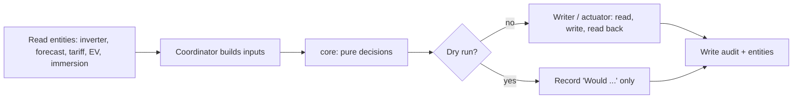

#### 0.3 Rules every feature obeys (from the repository's guardrails)
Dry run first on every write path. Writes only through the writer. No forced export or discharge, no rate or reserve writes. Never stop, pause or fast-charge an EV. `core/` stays pure. Optional devices may be absent. Entity ids and unique ids never change. A new option is added to `const.py` and to the reload policy with a test. Docs are generic, in UK English, and roadmap ids are not used in user-facing text.

#### 0.4 Patterns reused below
- **Diagnostic notice.** A sensor attribute holds a status code; a repair is raised only after the condition has held for a set time, and clears itself. Used by C32, C29, N3.
- **New option.** Constant, schema, translations, reload policy, wizard or options-flow field, test. Used by C28, C25, N21, N22, C31.
- **Window selection helper.** One pure function that picks cheapest slots (section 4.1). Used by C34, N13, N22 and the immersion ready-by plan.

#### 0.5 Index

| Id | Feature | Section | Size | Depends on |
|---|---|---|---|---|
| S19 | Anonymised system profile export | 1.1 | M | none |
| C32 | Say when the Solcast P10 attribute is off | 1.2 | S | FS1 findings |
| C29 | Read battery capacity live | 1.3 | S | U10 |
| N3, N11 | System types: detect, gate, say what is tested | 1.4 | L | S19, fixtures |
| N3, N11 | Detection and management in full: role resolver, aggregation, pre-flight, effect check, versions, re-detection, clock, upgrade survival (card SY4) | 1.5 | L | 1.4, fixtures |
| N12 | Forecast shape from the provider | 2.1 | L | FS1 |
| C33 | More forecast sources | 2.2 | S | 2.1 |
| N24 | Condition-matched forecast correction | 2.3 | L | history, backtest |
| C28 | Away mode | 3.1 | S | none |
| C25 | Round-trip loss in the simulation | 3.2 | S | golden changes |
| S5 | Survive to the cheap window (load-aware target) | 3.3 | M | none |
| N22 | Second charge window | 3.4 | L | fixtures, per-slot targets |
| N21 | Reserve ahead of a weather alert | 3.5 | M | none |
| S4, N4 | Immersion: energy cap, source price test, forecast-sized top-up | 4.2 | M | none |
| C18, C19, C20 | Surplus arbitration, smoothing, deadline | 4.3 | L | 4.2 |
| N13 | EV departure plan | 4.4 | M | 4.1 |
| C31 | More EV charger brands | 4.5 | M | fixtures |
| C34 | Cheap-period sensors | 4.1 | S | binary sensor platform |
| C30 | Expose entities to Assist | 5.1 | S | none |
| N19 | Per-module battery health | 5.2 | M | fixtures, C17 |
| N20 | Glance and wall views | 5.3 | M | none |
| N14 | Plan timeline card | 5.4 | M | none |
| N23 | Second inverter backend | 6.1 | L | backend interface |
| C20 | Periodic pasteurisation cycle | 4.3a | S to M | 4.2, 4.3 |
| C22 | Several forecast arrays | 2.4 | M | none |
| N1 | Charge by carbon intensity | 4.6 | M | 4.1, a decision |
| S17, N7 | Appliance cost per use | 4.7 | M | cycle detection |
| C17, N8 | Battery state of health and trend | 5.5 | M | fixtures |
| C23 | Backups, migration, fallback | 6.2 | L | none |

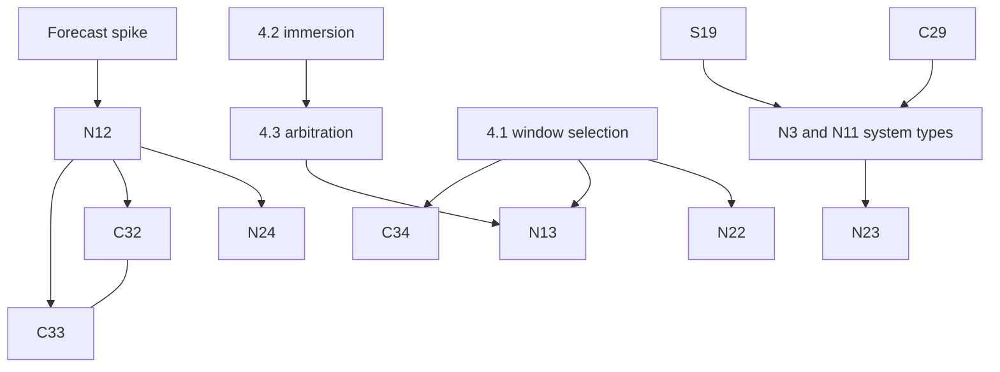

---

### 1. Supportability and system discovery

#### 1.1 S19: anonymised system profile export (M)

**Problem.** Support for All-In-One, gateway, three-phase, EMS and several-inverter systems cannot be proved without real entity lists, and users cannot be expected to copy hundreds of states by hand. A one-click, safe export makes every configuration testable and every bug report self-contained.

**What others do.** givenergy-hass has a capture action that records redacted traffic and links a landing page; givenergy-cli can export a redacted plant dump with serial numbers redacted by default. Both exist for the same reason.

**Design.** A service returns a response and also writes a JSON file; a persistent notification names the path. Nothing leaves the machine.

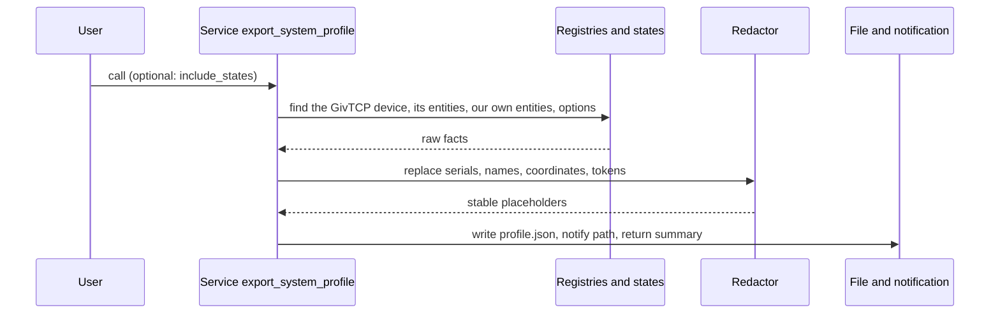

**Contents (all optional parts default off unless noted).**
- Integration version, Home Assistant version, GivTCP version where an entity or attribute carries it.
- For the inverter device: model and software version from the device registry; for each entity: id, domain, unit, device class, state class, whether enabled, and the **current state and the attribute names** (values only for an allow-list of harmless attributes).
- Counts and presence flags we use for classification (section 1.4): number of battery entities per module pattern, presence of per-phase power entities, presence of `Stack_*` entities, number of charge slots, presence of `Data_Age`.
- Our own options with secrets and money removed (rates are structure only: number of bands, not values).
- Never included: coordinates, names, email, IP addresses, tokens, anything under another integration except the **forecast** and **EV charger** entity ids and states we are configured to read.

**Redaction.** Build a map before writing. Find serials by pattern (two letters, four digits, a letter, three digits) and by the configured serial option. Give each distinct value a stable token (`SERIAL_1`, `SERIAL_2`) and substitute in entity ids, names and attribute values. Keep entity-id structure intact so the profile can be replayed as a fixture.

```text
function export_profile(hass, entry, include_states):
    facts = collect(hass, entry)                     # registries + states, read only
    mapping = new_token_map()
    for each text in facts: mapping.learn_serials(text)
    safe = facts.map_strings(mapping.replace)        # deterministic
    safe = drop_forbidden(safe)                      # coordinates, names, secrets, money values
    if size(safe) > LIMIT: safe = shrink(safe)       # drop attribute values first, then states
    path = write_file(config_dir, "profiles", timestamp, safe)
    notify(path)
    return summary(counts, path)
```

**Edge cases.** No GivTCP device (return what exists and say so). Very large installs (size limit, drop values before names). A serial inside a free-text attribute (replace everywhere). A second inverter (tokens per serial).

**Tests.** No serial or coordinate survives any fixture. The same input gives the same output. The profile loads back as a fixture in `tests/fixtures/systems/`. The service works with GivTCP absent.

**Open questions.** Whether to offer the file through a download link (needs a served path) or only a path. Whether to add a "share this" step that opens a pre-filled GitHub issue.

#### 1.2 C32: say when the Solcast P10 attribute is switched off (S)

**Problem.** The pessimistic forecast reads the `estimate10` attribute of the Solcast tomorrow sensor (`FORECAST_P10_ATTRIBUTE`). Solcast lets users switch some attributes off, so the integration can silently lose its P10 blend. Documentation in `docs/configuration.md` assumes the attribute exists.

**Design.** A status code, then a late, low-severity repair.

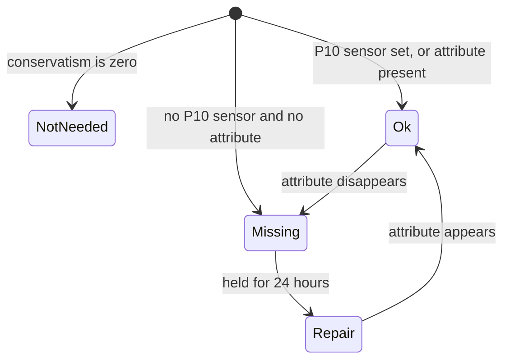

```text
function p10_status(conservatism, p10_entity_state, forecast_state):
    if conservatism <= 0: return NOT_NEEDED
    if p10_entity_state is a number: return OK
    if forecast_state is available and attribute "estimate10" is a number: return OK
    if forecast_state is available: return MISSING
    return UNKNOWN                          # forecast itself unavailable, say nothing
```

**Surface.** Attribute `forecast_p10_status` on the existing diagnostics sensor. Repair text: "The pessimistic forecast is not being used because the Solcast sensor has no P10 attribute. In the Solcast integration's options, enable the estimate 10 attributes." **Check** the exact option name in card FS1 before writing the text. The repair appears only after 24 hours of MISSING so a restart does not trigger it.

**Tests.** Four states of the table above, the 24-hour gate (injected clock), repair cleared when the attribute returns.

#### 1.3 C29: read the battery capacity live (S)

**Problem.** `CONF_BATTERY_CAPACITY` is read once at setup. Adding a module, or an inverter reporting a different capacity, needs a visit to Configure.

**Design.** Keep the configured value as the fallback and the user's override. Each cycle compute an **effective capacity** from live entities, accept it only if plausible, and expose which source was used.

```text
function effective_capacity(configured, reported, calculated, user_override):
    if user_override is set: return user_override, "override"
    for candidate, name in [(calculated, "module-based"), (reported, "reported")]:   # order is a design choice, see open question
        if candidate is a number and 0.5 * configured <= candidate <= 2.0 * configured:
            return candidate, name
    return configured, "configured"
```

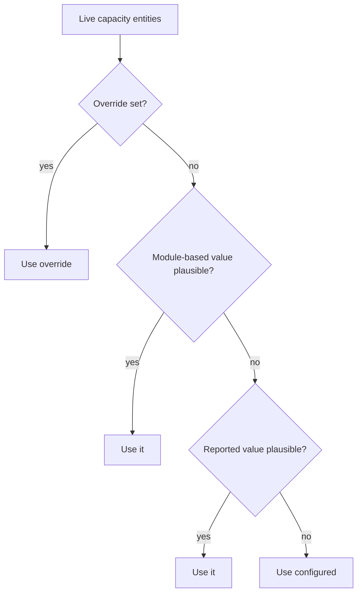

**Surface.** A diagnostic attribute `capacity_source` and `capacity_kwh`. Log once when the effective value changes by more than 5 percent. Never write the option.

**Open questions.** GivTCP publishes a reported value and a module-calculated value (`Battery_Capacity_kWh` and `Battery_Capacity_kWh_calc`). Which matches usable energy on each system type is **not verified** (fixtures needed). Whether "usable" should subtract the reserve (the existing code decides; **check**).

#### 1.4 N3, N11: system types (large)

**Problem.** The integration is proved on one single-phase hybrid. All-In-One, gateway, three-phase, EMS, AC-coupled and several-inverter systems may load but behave wrongly (wrong sign, wrong capacity, writes to an inverter that ignores them).

**What others do (SPEC-005, official API).**
- Identify the plant from a device type code, with the first digit giving the family and later digits the variant; generation from firmware; **version numbers are not comparable across families**.
- Probe peripherals and **drop any that respond with all zeros** (ghost slots).
- Gate entities by model; a Gateway's inverter-shaped values read zero and the real data sits in gateway-specific values; a Gateway offered no controls in that integration.
- The official API marks a controller with `is-controllable`; a child inverter "will respond to commands but may not change its behaviour".
- Publish a validated and untested support table.

**Design: classify from what GivTCP gives us, in a ladder.**

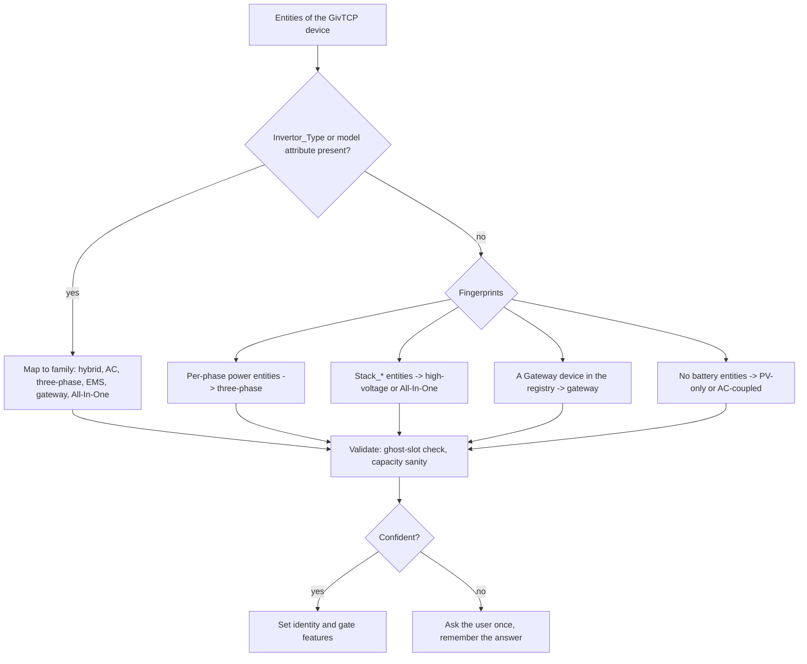

```text
InverterIdentity { kind, generation or None, phases, battery_modules, is_controller, confidence, evidence[] }

function classify(device_entities, registry_info):
    evidence = []
    kind = from_model_attribute(device_entities)          # may be None, see U10
    if kind is None: kind = from_fingerprints(device_entities, evidence)
    modules = count_real_modules(device_entities)         # an all-zero module is not real
    controller = decide_controller(kind, registry_info)   # a gateway controls its All-In-One units;
                                                          # a lone All-In-One controls itself;
                                                          # ambiguous: ask
    return InverterIdentity(kind, ..., modules, controller, confidence_from(evidence), evidence)
```

**Gating table (design).**

| Kind | Read | Write charge settings |
|---|---|---|
| Single-phase hybrid | all | yes |
| AC-coupled | battery values; **solar counters may be battery output** (SYS-06, U12) | yes, to the battery inverter |
| Three-phase hybrid | sum phases; signs per fixture | yes if the target entity exists |
| All-In-One alone | as hybrid, solar counters may differ | yes |
| All-In-One behind a gateway | via the gateway | **gateway only**; never the child (SYS-25) |
| Gateway | whole-house values from the gateway device | only if proved (U9) |
| EMS plant | read only | **no**: the controller reasserts settings (SYS-26) |
| Unknown | read what exists | no writes until the user confirms |

**Surface.** A diagnostics sensor `system_type` with evidence; a wizard step only when the answer is ambiguous; a support table in the docs with "validated" and "untested" per kind.

**Edge cases.** GivTCP 3.6 renamed entities for the high-voltage Gen 3 hybrid. A custom entity prefix. A second GivTCP instance. A GivTCP version older than the floor.

**Tests.** One fixture per kind (from S19). The classifier is pure and table-driven. A ghost-slot case. A "write refused on a child" case with a read-back that looks successful.

**Open questions.** U5, U9, U10, U11 in the brief.

#### 1.5 Inverter detection and management: the complete design

Section 1.4 says how to classify. This section covers everything else that detection and management need: what to read for each role on each kind of system, what to write, how to know a write can work, how to know it did, and how to cope when the system changes. Entity names below are **concepts**. Each one is checked against a fixture before it is used (card SY0), because GivTCP's names and sign conventions changed between versions.

##### 1.5.1 The identity and capability model

```text
Identity   { kind, generation or None, phases, modules[], is_controller, controller_id or None, version, evidence[], confidence }
Capability { can_read[roles], can_write_target, can_write_window, window_slots, per_slot_targets, rate_limit_known, clock_readable }
System     { inverters[Identity], capabilities[per inverter], controller_choice, aggregate_rules }
```

Capabilities come from **what exists and is writable**, not from the kind alone. A kind sets defaults; entity presence overrides them. GivTCP itself reports "not available for EMS inverters" on controls it cannot apply, which is a free signal.

##### 1.5.2 The role resolver

Every feature reads four power roles, one state of charge and one capacity. The resolver returns, for each role, the entity or entities to use and the transform to apply, so no other code knows about kinds.

| Role | Hybrid | AC-coupled | All-In-One alone | Parallel All-In-One behind a gateway | Three-phase | EMS plant |
|---|---|---|---|---|---|---|
| Solar | inverter PV power | the separate PV inverter's power, **not** the battery inverter's (SYS-06) | none, or a separate PV source | gateway PV power | inverter PV power (sum of strings) | plant rollup |
| Battery power | inverter battery power | same | same | gateway total, **sign fixed before GivTCP 3.6** | same | plant total |
| Grid power | inverter grid power | same | same | gateway whole-house grid | sum of phases or the total, per fixture | meter rollup |
| House load | inverter load | same | same | gateway whole-house load | same | plant load |
| State of charge | one value | one value | one value | per unit, **capacity-weighted** | one value | plant value |
| Capacity | sum of modules | sum of modules | sum of modules | sum of all units' modules | sum of modules | sum |

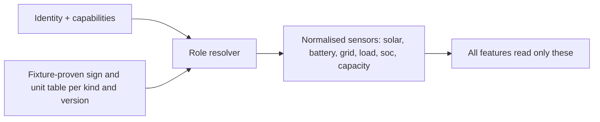

```text
function resolve(role, identity, system):
    source = SOURCE_TABLE[identity.kind][role]            # a role -> entity suffix list, per kind
    if source is None: return Unavailable(reason)         # a feature that needs it switches itself off
    entities = find(identity.device, source)
    value_fn = TRANSFORM[(identity.kind, role, version_band(identity.version))]   # sign, unit, scaling
    return Resolved(entities, value_fn)
```

Normalise to **one convention inside the integration** (the documented one in `CLAUDE.md`) and convert at the boundary. A wrong sign is the commonest silent error here.

**Normalised flows (GivTCP 3.6).** GivTCP now publishes `Solar_to_House`, `Solar_to_Battery`, `Solar_to_Grid`, `Battery_to_House`, `Battery_to_Grid`, `Grid_to_House` and `Grid_to_Battery` for single-phase, three-phase and Gateway systems (PV-only inverters publish only the two solar flows). Each is non-negative, and the flows into the house never exceed the load. These are a ready, consistent source for surplus decisions on every model: the surplus available to divert is `Solar_to_Grid` plus any solar charging a battery that is above its threshold. **Check** on fixtures that they agree with the values the integration derives itself, and fall back to the derived values where the flows are missing (older versions).

**Battery-only child devices.** When GivTCP's "only report battery data and controls" is set (usually for units behind an EMS or Gateway), those devices publish only battery data and controls. Whole-house values come from the Gateway or EMS device, and the resolver never reads a role from a device that does not publish it.

**Aggregation rules.**
- A **gateway** system: read the gateway's whole-house values; the units supply per-unit state of charge only.
- **Independent inverters** (not parallel, each with its own battery): control one chosen inverter; for **reads**, sum solar, load and battery power, and capacity-weight the state of charge. State on the dashboard that the figures combine several inverters.
- **Mixed or unknown**: no aggregation; ask once.

```text
function combined_soc(units): return sum(u.soc * u.capacity for u in units) / sum(u.capacity for u in units)
function combined_power(units, role): return sum(unit value in normalised sign)
```

##### 1.5.3 What can be written, and where

| Question | How it is answered |
|---|---|
| Which entity sets the target? | Probe: the single target entity with the enable switch, or the per-slot target entities (`Charge_Target_SOC_N`) when they exist. Record the choice in the capability. **Which one wins when both exist is U8** |
| Which window entities? | Slot 1 start and end. A second slot only for N22 |
| Which device receives it? | `identity.controller_id` only; never a child inverter, never an EMS-managed unit |
| What happens if the entity is missing or not writable? | The capability says no, the feature reads only, and the system sensor says why |
| How many writes per night? | The existing limits (retry offsets, at most three re-plan writes) |

##### 1.5.4 Pre-flight: "can this inverter charge tonight?"

A write can succeed and still be useless. Before the nightly write, and again at window start, compute readiness and publish it.

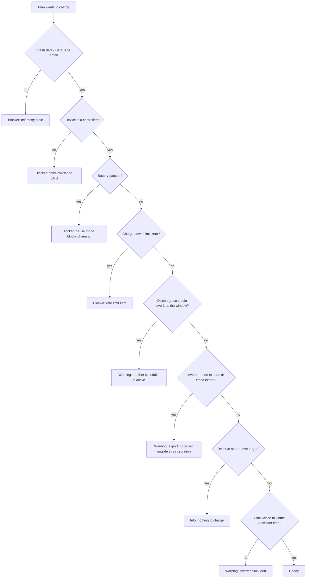

```text
function charge_readiness(identity, caps, state, plan, now):
    blockers, warnings = [], []
    if state.data_age_s > STALE_AFTER_S:        blockers += "Telemetry is stale"
    if not identity.is_controller:               blockers += "This device does not accept charge commands"
    if state.pause_mode in (PauseCharge, PauseBoth) and now_in(state.pause_slot):   blockers += "Battery charging is paused"
    if state.charge_rate_limit == 0:             blockers += "Charge power limit is zero"
    if state.status == "paused":                 blockers += "GivTCP has paused sending to the inverter"
    if state.discharge_schedule_overlaps(plan.window): warnings += "A discharge schedule overlaps the window"
    if state.mode == "Timed Export":             warnings += "The inverter is set to timed export"
    if state.mode == "Eco (Paused)":             warnings += "Eco mode is paused"
    if state.reserve_pct >= plan.target_pct:     info += "Reserve is at or above the target"
    if abs(state.inverter_clock - now) > CLOCK_TOLERANCE: warnings += "Inverter clock differs from Home Assistant"
    return Readiness(ok = not blockers, blockers, warnings, info)
```

**Rules.** The integration **reports** these; it does not fix them by writing reserve, rate or mode settings (the guardrails forbid rate, reserve and export writes, except the repair for conflicting slots that already exists). The charge target write still goes ahead when only warnings exist. A blocker records in the audit that the write would have no effect, and the plan sentence says why.

**Entities (confirmed in the GivTCP 3.6 datapoints list; exact ids and strings still need a fixture).**

| Check | GivTCP entity | Values |
|---|---|---|
| Freshness | `Data_Age`, `Time_Since_Last_Update`, `status` | seconds, seconds, `online` or `paused` |
| Pause | `Battery_pause_mode` with the pause start and end time slots | `Disabled`, `PauseCharge`, `PauseDischarge`, `PauseBoth`; applies only inside the pause slot |
| Mode | `Mode` | `Eco`, `Eco (Paused)`, `Timed Demand`, `Timed Export` |
| Charge power limit | `Battery_Charge_Rate` | watts; 3.6 fixed values that stopped just short of the maximum |
| Reserve | `Battery_Power_Reserve` | percent |
| Schedule | `Enable_Charge_Schedule`, `Enable_Charge_Target`, `Target_SOC`, `Charge_Target_SOC_N` | switches and numbers |
| Clock | `Invertor_Time` | timestamp |

A missing entity means that check is skipped, never that it fails. These exist only on the models GivTCP lists (pause is absent on older Gen 1 firmware, three-phase and EMS, for example).

**Surface.** A diagnostic sensor `charge_readiness` with `blockers`, `warnings`, `info`; reuse the dashboard banner built for the conflict warning (card CC3) for blockers.

##### 1.5.5 Did the write have an effect?

A correct read-back proves the setting is stored. It does not prove the inverter acts on it (a child inverter ignores commands; an EMS reasserts its own). Check behaviour as well.

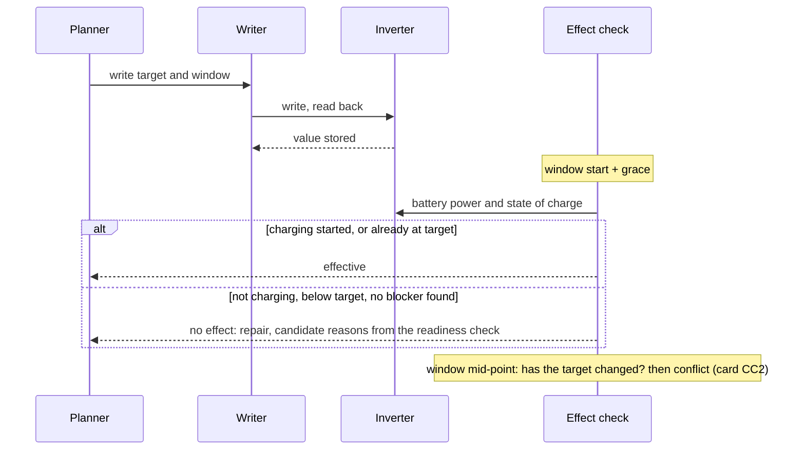

```text
function check_effect(readiness, window_start, now, soc, target, battery_power_signed):
    if now < window_start + GRACE: return PENDING
    if soc >= target - TOLERANCE: return EFFECTIVE
    if battery_is_charging(battery_power_signed): return EFFECTIVE
    return NO_EFFECT(reasons = readiness.blockers + readiness.warnings)
```

`NO_EFFECT` raises a low-severity repair after the second consecutive night, never retries the write in a loop (the retry offsets already bound it), and never changes any setting. On a gateway-controlled or EMS system this is the signal that tells the user the integration is not in control (SYS-25, SYS-26).

##### 1.5.6 Freshness and version policy

- **Freshness.** `Data_Age` (seconds, minus one when no data), `Time_Since_Last_Update` and `status` (`online` or `paused`) are the signals. Treat `paused` as not publishing. A large value, or minus one, means the inverter is not publishing, even if states look current, because GivTCP republishes stale values. All features read through one `is_fresh()` gate; stale data means "unavailable", not "last value".
- **Version policy.** Decide by **entity presence first**. Use the GivTCP version only to apply a **known correction** from a table, for example the gateway battery-power sign before 3.6, or the 3.6 re-reading of the high-voltage Gen 3 hybrid. Below the supported floor (U11), run read-only and say so.

| Version band | Correction | Source |
|---|---|---|
| older than 3.6 | gateway battery power sign inverted | GivTCP 3.6.0-beta1 release notes |
| 3.6 | high-voltage Gen 3 hybrid no longer read as three-phase or All-In-One; entities renamed | same |
| 3.6 final | Gateway energy totals change from MWh (labelled kWh) to kWh, a one-off 1000 times step | 3.6 release notes |
| 3.6 final | AC and All-in-One lose the PV string entities; `PV_Power` (total) remains | same |
| 3.6 final | Battery BMS Current renamed Battery Pack Current; reads 0 where unsupported | same |
| 3.6 final | "Only report battery data and controls" takes effect | same |
| 3.6 final | Gateway controls work; per-slot targets and rates on the Gateway | same |
| 3.6 and 3.6.1 | entity ids reset to GivTCP defaults when a discovery config changed; fixed in 3.6.2 | 3.6.2 changelog |
| 3.6.0 | charge slot 2 on 10-slot inverters at the wrong registers; fixed in 3.6.1 | 3.6.1 changelog |
| 3.6.0 | PV-only inverters return no data; fixed in 3.6.1 | 3.6.1 changelog |
| any | the add-on's own config file showed `3.5.68` at the 3.6 tag: do not trust the version string alone | GivTCP repository, tag 3.6 |
| any | per-slot targets exist on some inverters | datapoints list |

##### 1.5.7 When the system changes

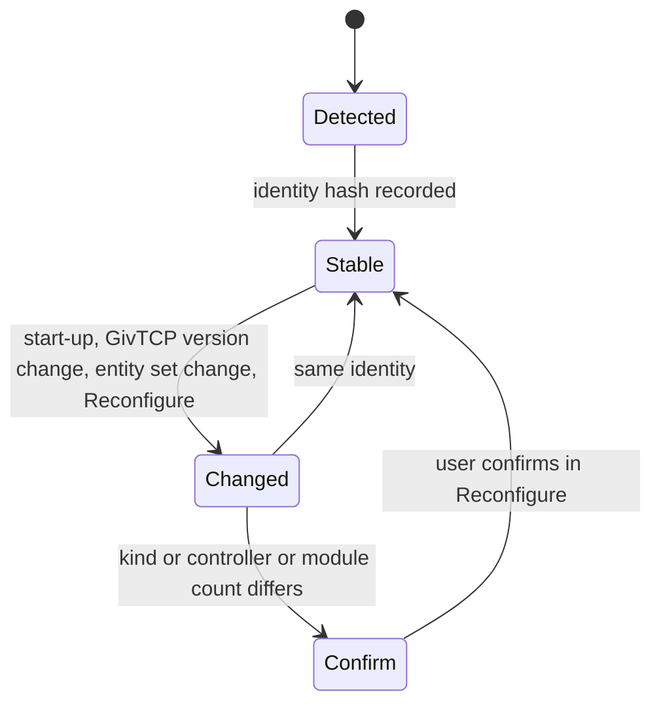

Compute an **identity hash** from kind, controller, module count and the set of role entities. On any trigger, recompute. If it differs, **do not switch controller or capacity silently**: keep the stored choice, raise a repair "The system looks different (battery modules 2 to 3), confirm in Reconfigure", and show what changed. A changed module count alone updates the live capacity (C29) without a repair.

##### 1.5.8 Clock drift

The charge window runs on the inverter's clock. A clock 20 minutes out moves the window into a dearer period, and GivTCP 3.6 says the Today energy counters then reset at the wrong time. GivTCP now **warns when the clock is 5 minutes or more out**, publishes the inverter clock as the `Invertor_Time` sensor (a timestamp), and has a `Sync_Time` button. givenergy-hass offers a clock drift repair as well, and notes that an EMS controller's clock cannot be set locally.

Design: compare `Invertor_Time` with Home Assistant time each cycle. At 5 minutes or more, add a readiness **warning** (section 1.5.4) that says by how much. **Do not set the clock** in this release: that is a write the integration does not own. Where `Invertor_Time` is missing, skip. Tolerance 5 minutes, matching GivTCP, to be confirmed on a fixture.

#### 1.5.9 Test harness

- **A fake inverter per kind** (card IB7's `tests/fakes/fake_inverter.py`), built from the fixtures, each able to: report fresh or stale data, store a write, ignore a write (child), revert a write (EMS), report pause or a zero rate limit, and drift its clock.
- **Contract tests** run every scenario against every fake through the backend interface.
- **Matrix** (rows are kinds, columns are scenarios): classify, resolve roles, readiness, write, effect, change detection. A cell is "proved on real hardware", "fixture only" or "not tested", and the docs publish that table (card SY3).

| Scenario | Expected |
|---|---|
| Hybrid, healthy | classify, write, effective |
| Hybrid, battery paused | readiness blocker, write skipped or recorded as no effect |
| Parallel All-In-One behind a gateway | control the gateway; a write to a unit is refused by the writer |
| Gateway before 3.6 | battery power sign corrected |
| EMS plant | read only; readiness blocker |
| Three-phase | grid sum correct; target entity per fixture |
| Custom entity prefix | found by suffix |
| Module added | capacity updates, no repair |
| Kind changes | repair, stored choice kept |
| Stale data | features report unavailable, no writes |

##### 1.5.10 What is still unknown here

GivTCP 3.6 (11 October 2026) answers several: `Invertor_Type`, `GivTCP_Version`, `Data_Age`, `status` and `Invertor_Time` are sensors (U10); SmartTarget is not an entity (U1); the shipped rate defaults are known (U6); the Gateway has working controls, rates and per-slot targets (U9, mostly); `Enable_Charge_Target` semantics are documented (U8, partly). **Still unknown:** the exact `Invertor_Type` strings, entity ids per configuration (U5), whether `Target_SOC` alone governs a charge on 10-slot inverters (U8), which entity to write for a parallel All-in-One system (U9), whether the solar energy counters on AC-coupled and All-in-One systems are solar (U12), what a child inverter's entities show after an ignored write, and the supported version floor (U11). Each is answered by fixtures from S19 and by one real test night.

#### 1.5.11 Surviving a GivTCP upgrade (card SY4)

The 3.5 to 3.6 upgrade changes entity sets and, on a Gateway, the units of the energy totals. The integration must notice, not break, and not book false energy.

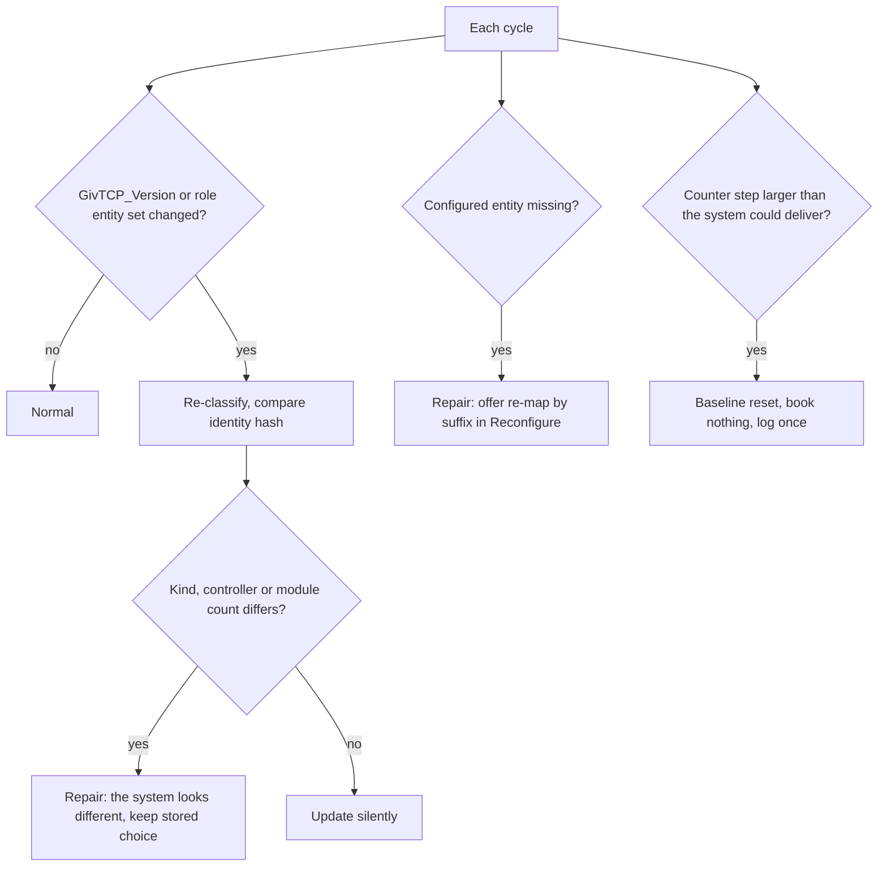

```text
function guard_counter(prev, now, elapsed_s, max_power_w, margin=1.5):
    if now < prev:                       return RESET                       # a normal counter reset
    plausible_max = max_power_w * elapsed_s / 3600 / 1000 * margin          # kWh the system could deliver
    step = now - prev
    if step <= plausible_max:            return BOOK(step)
    if 900 <= step / max(prev, 1e-9) <= 1100 or 900 <= now / max(prev, 1e-9) <= 1100:
                                         return RESET_LOG("probable unit change, about 1000 times")
    return RESET_LOG("implausible counter step")
```

**Entity references.** Resolve every GivTCP entity through the registry unique id, falling back to the stored entity id:

```text
function resolve_entity(ref, registry):
    ent = registry.by_unique_id(ref.unique_id)
    if ent: return ent.entity_id                    # follows a rename or an id reset
    if registry.exists(ref.entity_id): return ref.entity_id
    return None                                      # missing: repair, never guess
```

**Worked example.** A Gateway total of 12.68 kWh reads 12,682.7 kWh one cycle later. The step is far above what a 6 kW system could deliver in a minute (0.15 kWh with margin), and the ratio is about 1000, so nothing is booked and the baseline moves.


---

### 2. Forecast

#### 2.1 N12: the forecast's own shape (L)

**Problem.** The simulation spreads tomorrow's solar over a fixed bell curve centred on 13:00. A day with a bright morning and a dull afternoon, or an east-west array, is simulated wrongly, so the target is off by the amount of solar that arrives at the wrong time.

**What others do.** PALM and Predbat use the provider's half-hourly estimates (PALM sums arrays, aligns to local time, and blends the 10, 50 and 90 percent estimates). Home Assistant gives three routes to the same data (details from documentation, **unverified on live instances**):
1. the **solar-forecast platform** the Energy dashboard uses (a timestamped energy-per-period profile, for any provider that supports it);
2. a **provider action** (Forecast.Solar has one returning `watts` and `wh_period`, raw or hourly);
3. **sensor attributes** (Solcast `detailedForecast`, 30-minute periods with start time and 10, 50 and 90 percent values; Open-Meteo `watts` and `wh_period`).

**Key design insight.** We only need the **shape**, so the profile is normalised to sum to one. Whether a source reports kW or kWh makes no difference if its periods are equal in length. We therefore do not need to resolve the units question to use a shape; we only need the period start times and a consistent period length.

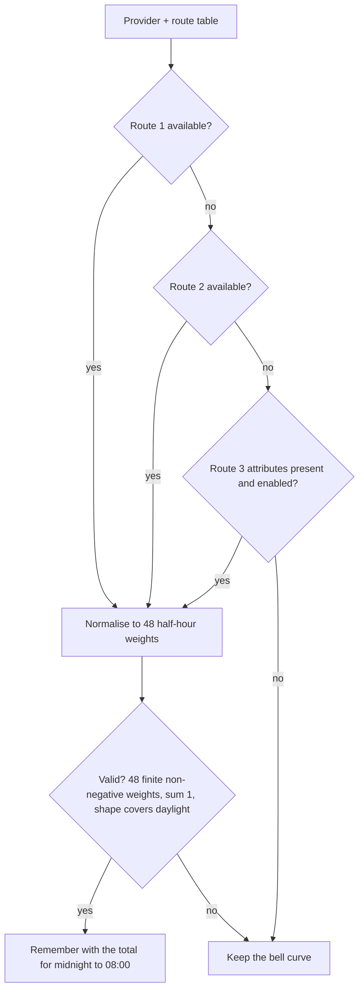

```text
function shape_from_periods(periods, tz):
    # periods: list of (start_time, value) for tomorrow, any equal or mixed length
    slots = [0.0] * 48                                  # local half-hours
    for each period p with next start n (or inferred length):
        for each local half-hour h overlapping [p.start, n):
            slots[h] += p.value * overlap_fraction(h, p) # split by overlap, so hourly splits to two halves
    total = sum(slots)
    if total <= 0 or any(x < 0 or not finite): return None
    weights = [x / total for x in slots]
    if daylight_mass(weights) < 0.9: return None         # guards against a bad day or wrong date
    return weights
```

**Daylight saving.** Map by local clock time. On the two odd days (46 or 50 real slots) build the 48 slots from local clock labels and fill the missing or doubled hour by splitting or merging; if that is ambiguous, return None and use the bell curve for that day.

**Remembering.** The forecast sensor moves to the next day at midnight. Keep the last good shape and total together so 00:00 to 08:00 still has one (the same reason the code remembers the total just before midnight).

**Where.** `core/solar_day.py` gets the pure function; `ChargeInputs` gains `solar_shape`; `coordinator.py` reads the route and passes it in; `core/rules.py` `_simulated_plan` uses it when present. A new plan-forecast attribute `solar_profile_source` records `bell`, `platform`, `action` or `attributes`.

**Test vector.** Hourly provider values from 08:00 to 16:00 of 100, 300, 600, 900, 1000, 900, 600, 300, 100 (sum 4800). Each hour's share of the day is 0.0208, 0.0625, 0.125, 0.1875, 0.2083, 0.1875, 0.125, 0.0625, 0.0208 (sum 1.0000). Split evenly across its two half-hours, the 12:00 hour gives 0.1042 to each of 12:00 and 12:30. The same data in kW or kWh gives identical weights.

**Edge cases.** Mixed hourly and half-hourly periods. A provider that gives only a daily total (keep the bell curve). A timezone-aware versus naive timestamp. Today's partial day (we only use tomorrow's).

**Tests.** The vector, DST days, invalid inputs returning None, and a golden for a day with a skewed shape (a behaviour card that moves goldens on purpose).

**Order.** Card FS1 (spike) first. Do not start until the three routes are checked on real instances.

#### 2.2 C33: more forecast sources (S)

**Problem.** People without a Solcast account choose Open-Meteo Solar Forecast (free, no key) or a learned source such as Helios Forecast. The wizard and docs name only Solcast and Forecast.Solar.

**Design: a small adapter table, one row per provider.**

| Provider | Tomorrow total | P10 | Shape route | Notes |
|---|---|---|---|---|
| Solcast | tomorrow sensor | `estimate10` attribute (may be off, see C32) | attributes, platform | multi-site sums on its side |
| Forecast.Solar | tomorrow energy sensor | none | action, platform | no P10: conservatism has no effect |
| Open-Meteo Solar Forecast | tomorrow energy sensor (**check name**) | none | attributes `watts`, `wh_period` | free, no account |
| Helios Forecast | **check** | **check** | action `helios_forecast.get_forecast` | learns from your own production |

```text
function suggest_sources(hass):
    for each integration in table: if installed and its tomorrow sensor exists:
        offer it, with a note on P10 and shape support
```

**Docs.** One table in `docs/configuration.md`. **Tests.** Fixtures per provider (S19 helps). **Dependency.** 2.1 for shape routes.

#### 2.3 N24: condition-matched forecast correction (L, research first)

**Problem.** One accuracy ratio corrects the whole forecast. A site with shading in the afternoon, or one that over-forecasts only on cloudy days, is corrected the same amount every day.

**What others do (SPEC-009).** Helios finds past hours with similar conditions (cloud, sun altitude, temperature, azimuth, weighted), reads the ratio of actual to model for those hours, applies the median ratio to today's physical forecast, uses the 10th and 90th percentile ratios as a band, and blends back toward the plain model when few close analogs exist.

**Our version, much smaller.** We have no hourly production or weather history, so work at **daily** level with what we hold: past forecast totals and actual totals.


```text
function corrected(forecast_kwh, today, history, k=15, k0=5):
    candidates = [d for d in history if d.forecast_kwh > 0 and d.actual_kwh is known]
    if len(candidates) < 10: return forecast_kwh, None
    dist(d) = w1*|norm(d.forecast_kwh) - norm(forecast_kwh)| + w2*seasonal_gap(d.date, today)
    nearest = k smallest by dist
    ratios = sorted(d.actual_kwh / d.forecast_kwh for d in nearest)
    median, p10, p90 = quantiles(ratios)
    confidence = len(nearest) / (len(nearest) + k0)
    ratio = 1 + confidence * (median - 1)
    return forecast_kwh * ratio, (forecast_kwh * p10, forecast_kwh * p90)
```

**Research first.** Build `tools/backtest_forecast.py` that replays the stored history and reports error with and without the correction against the existing accuracy scaling. **Ship only if it beats the current method on held-out days.** Weights `w1`, `w2` and `k` are tunables to fit from that backtest, not fixed here.

**Risks.** Overfitting on a short history. Interacting with the existing scaling (replace it, do not stack). Day-to-day noise in the actuals (exclude days with outages or heavy EV charging if they distort the actual).

**Open questions.** Which "actual" the integration holds (solar energy from GivTCP, which on AC-coupled and All-In-One systems may be battery output, U12).

#### 2.4 C22: several forecast arrays (M)

**Problem.** A house with east and west arrays may have two forecast sensors (for example two Forecast.Solar planes as separate entries). One sensor is used today, so the plan sees half the solar. A template sensor that sums them works, but the shape, the P10 and the day-after value are then lost.

**Design.** Accept a **list** of forecast entities for tomorrow, and sum them consistently.

```text
function combine(arrays):
    if any array is unavailable: return Partial(use_none=True)       # a partial sum is worse than none
    total = sum(a.tomorrow_kwh)
    p10 = sum(a.p10) if all arrays have p10 else None
    shape = sum_by_period(a.periods) normalised   if all arrays have periods else None
    return Combined(total, p10, shape)
```

**Rules.** A missing array makes the whole forecast unavailable for that cycle, and the plan falls back to its remembered value and says so. Arrays with different update times use their last good values. Solcast already sums its own sites into one sensor, so this is for sources that do not. **Tests.** Two arrays with and without P10, one unavailable, mixed period lengths. **Options.** The forecast entity field becomes a multi-select; the stored single value is read as a list of one.

---

### 3. Charge planning

#### 3.1 C28: away mode (S)

**Problem.** A week away fills the learned load history with low days. After you return, the plan believes the house uses little, so it under-charges for several days. While away, the plan is pessimistic about load and over-charges.

**What others do (SPEC-003).** Predbat counts away days down at midnight, records that value, and when predicting a day uses only past samples with the same away state; with none, it scales all history by an assumed away fraction (or divides by it on return). A drop-the-lowest-day filter ignores one unusually quiet day.

**Our version.** The history we keep is per day (`slot_load_history` entries of 48 slots plus coverage), so match **per day**, not per five-minute sample.

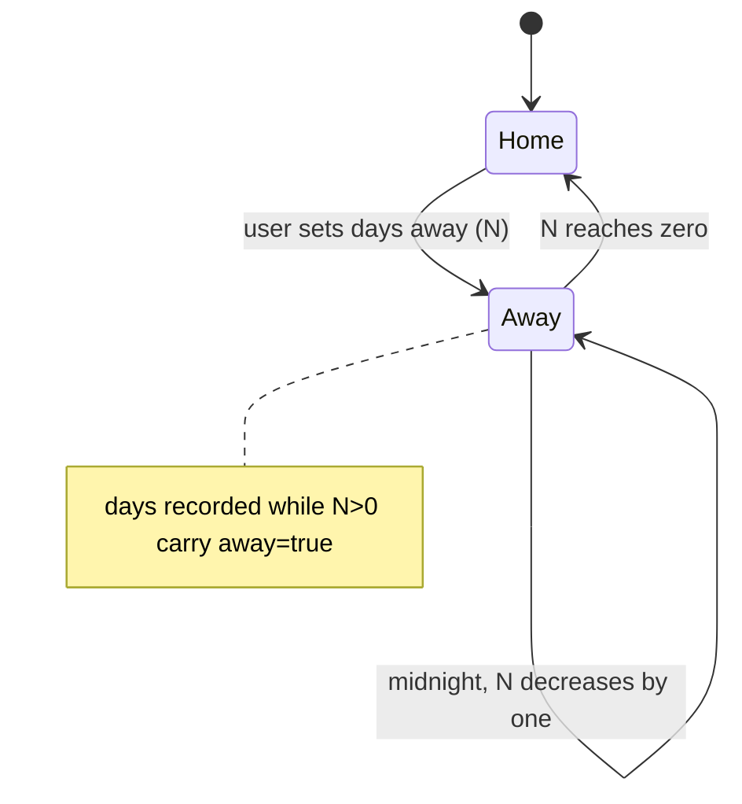

**Entities and options.**
- A number entity "Days away" (0 to 60; live; resets at zero; counts down at local midnight).
- Option `away_load_fraction` (0.1 to 1.0). The default is a design value to be validated on real histories, not copied from anywhere.
- Each daily history record gains `away: bool`, set when more than half of the recorded day had N above zero.

```text
function profile_for(target_day_offset, history, away_days_left, fraction):
    target_away = away_days_left > target_day_offset          # offset 0 is today, 1 is tomorrow
    matching = [d for d in history if d.away == target_away and d.coverage >= MIN_COVERAGE]
    if len(matching) >= MIN_DAYS:
        return build_load_profile(matching, target_weekday)   # existing weighting; skip weekday split when target_away
    everything = [d for d in history if d.coverage >= MIN_COVERAGE]
    if len(everything) >= MIN_DAYS:
        base = build_load_profile(everything, target_weekday)
        if target_away: return base * fraction
        return base / fraction if every_day_in_window_was_away(history) else base
    return None
```

**Worked vector.** History: seven home days averaging 0.50 kWh per slot, three away days averaging 0.20, today home.
- Tomorrow still away and away history exists: profile 0.20.
- First day away (no away history yet): 0.50 x 0.5 = **0.25** (fraction 0.5).
- Day home after a long trip when every day in the window was away: 0.20 / 0.5 = **0.40**.
- Home with home history: 0.50.

**Optional.** A notification "Load looks very low for two days, are you away?" when the last two days are below 40 percent of the profile and away is zero (threshold to be fitted).

**Tests.** The four cases above; the countdown across midnight with an injected clock; a restart mid-trip keeps N; the `away` flag survives history rotation. Goldens do not move with N=0.

**Edge cases.** Away longer than the history. Setting N after leaving. A day partly away (the majority rule).

#### 3.2 C25: battery round-trip loss in the simulation (S)

**Problem.** The forward simulation assumes no loss between grid, battery and house, so it plans slightly too little.

**What others do.** Predbat models inverter and battery loss separately and its configuration guide suggests around 4 percent each for a hybrid.

**Design.** One efficiency pair in `const.py` (`CHARGE_ROUND_TRIP_EFFICIENCY` split as charge and discharge, default 0.96 each, to be checked against measured data), used wherever energy moves in or out of the battery in the simulation.

```text
per half-hour slot:
    load_after_solar = load - solar_used_directly
    if load_after_solar > 0:   battery_draw = load_after_solar / eta_discharge     # needs more from the battery
    else:                      battery_gain = surplus * eta_charge                  # stores less than the surplus
grid_energy_for_target = (target_soc - start_soc) * capacity / eta_charge
```

**Worked example.** 5 kWh of evening load draws 5 / 0.96 = 5.21 kWh from the battery. A 3 kWh surplus stores 2.88 kWh. One kWh stored from the grid costs 1.04 kWh.

**Behaviour card.** Targets rise by a few points; goldens move on purpose (`/regenerate-goldens`) and the PR explains each. Keep one constant; do not add an option.

**Tests.** The three figures above; targets monotone in efficiency (lower efficiency never lowers a target); a round trip at efficiency 1.0 reproduces the old numbers exactly (guards the refactor).

#### 3.3 S5: survive to the cheap window (M)

**Problem.** If the battery empties before the next cheap window, the house imports at the dearest rate. The day simulation covers 48 half-hours; a window that starts after midnight needs the evening and early hours too, and an unusual evening (guests, EV) is not in the profile.

**What others do (SPEC-001).** PALM's target is the largest of three numbers: room for tomorrow's solar to fill the battery, a lift to cover the dip before the sun arrives (the lowest point before the day's peak), and a seasonal floor. The dip term is the part to compare with ours (card SP1).

**Design.** Extend the simulation by the hours from midnight to the start of the next window, with no solar and the per-slot profile for the next day; require the state of charge at the window start to be at or above the minimum.

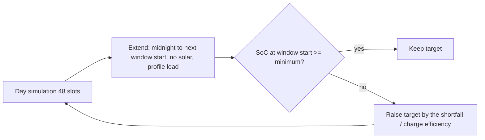

```text
function target_with_survival(start_target, day_sim, extension_slots, min_soc):
    soc = day_sim.end_soc(start_target)
    for slot in extension_slots: soc -= profile[slot] / eta_discharge
    shortfall = max(0, min_soc - soc)            # kWh
    return min(100, start_target + 100 * shortfall / (capacity * eta_charge))
```

**Unify with the night survival sensor** so the plan never skips a charge that sensor calls critical (the code already ties them through `hours_until_solar` and `estimate_will_survive_night`; **check** how far the existing sensor extends).

**Tests.** A window at 02:00 with a heavy evening profile raises the target; a window at 23:30 changes nothing; shortfall of zero leaves the target unchanged. Add the SPEC-001 vectors (card SP1) as comparison, not as assertions.

#### 3.4 N22: a second charge window (L)

**Problem.** Some tariffs have two cheap periods (a night one and an afternoon one). Only one window is used.

**What others do.** PALM added an afternoon Cosy period. A Homey app listing says Gen 1 and Gen 2 inverters have one charge slot.

**Constraints that shape the design.**
- A second slot needs an inverter that has one (**check** entity names).
- **Per-slot targets** exist only on some inverters (U8). With one shared target the second window's target must be written when it opens.
- The take-over-schedules repair (S1) flags any other active slot; slot 2 would become **ours** and must be exempt.
- Never force discharge; only charge slots.

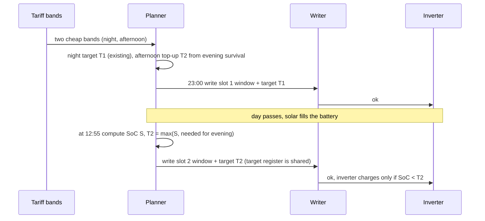

```text
function plan_two_windows(bands, profile, forecast, soc_now):
    cheap = bands where price < base_price
    windows = merge_adjacent(cheap) ; keep at most two
    t1 = overnight_target(...)                              # existing
    for second window: needed = evening_energy(profile, from=window2.end, to=next_window1.start) / eta_discharge
                       solar_expected = forecast_remaining(from=now)
                       t2 = clamp(soc_at(window2.start) + (needed - solar_expected) / capacity, 0, 100)
                       if t2 <= soc_at(window2.start): skip window 2      # nothing to buy
    return [(window1, t1), (window2, t2)]
```

**Edge cases.** Windows closer than the retry gap. A target write while a charge is running (U2). EV and battery sharing supply in both windows (C19). Daylight-saving days.

**Order.** After per-slot targets are understood (U8) and a fixture with a second slot exists. Own PR, own safety tests.

#### 3.5 N21: raise the target ahead of a weather alert (M)

**Problem.** A severe-weather warning raises the chance of a power cut. The battery is the home's backup, but the plan may leave it half full.

**Design: source-agnostic.** The user picks any entity that is "on" or "active" for an alert (a binary sensor, or a sensor whose state matches a list). No provider-specific code. **Read first** how Predbat's weather alert feature chooses and trusts a source; only its name was seen.

**Important limit.** The rules forbid writing a reserve. So the feature **raises the overnight charge target**, which is a permitted write, and does not touch the reserve register.

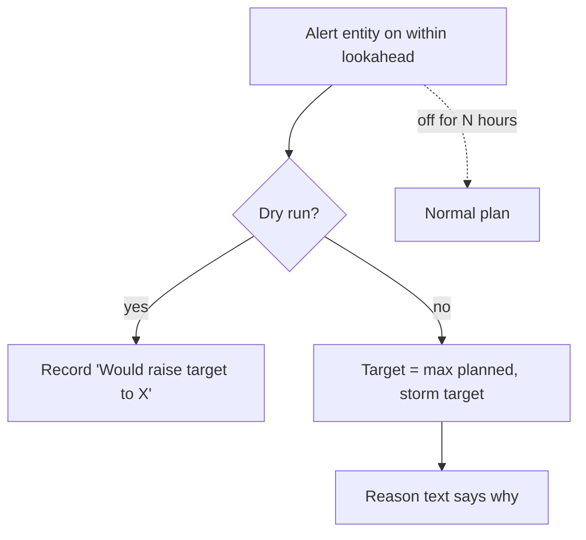

```text
function storm_target(planned_target, alert_active, storm_target_pct, alert_since, max_hold_hours):
    if not alert_active: return planned_target, None
    if hours_since(alert_since) > max_hold_hours: return planned_target, "alert held too long, ignored"
    return max(planned_target, storm_target_pct), "weather alert active"
```

**Options.** `weather_alert_entity`, `storm_target_pct` (default to be chosen, for example 100), `max_hold_hours` (so a stuck sensor cannot hold the battery full for ever). All live. **Tests.** On, off, stuck, dry run. **Edge cases.** An alert that flaps; a feed that is unavailable (treat as off).

---

### 4. Loads: tariff windows, immersion, EV

#### 4.1 C34 and the window selection helper (S)

**Problem.** Users want a dishwasher, a heat pump or a pool pump to run in the cheapest periods without writing templates. The integration already knows the tariff. Several features (C34, N13, N22, the immersion ready-by plan) each need "pick the cheapest slots", and each would otherwise grow its own copy.

**What others do (SPEC-006).** The Octopus target-rate sensors, now a separate integration, choose either one continuous block or separate cheapest periods, with minimum and maximum value limits, exact, minimum or maximum hours, a latest-or-earliest tie rule, and optional weighting. Its author calls this one of the integration's key features.

**Design: one pure function, used everywhere.**

```text
select_slots(periods, hours, mode, limits, prefer_latest, highest=False):
    # periods: time-ordered half-hours with a value. mode: "continuous" or "separate".
    need = ceil(hours * 2)
    if mode == "continuous":
        best = None
        for start in range(len(periods) - need + 1):
            block = periods[start : start + need]
            if any(outside(limits, p.value) for p in block): continue
            score = sum(p.value for p in block)
            if best is None or better(score, best.score, prefer_latest, highest): best = (block, score)
        return best.block or []
    else:
        ok = [p for p in periods if inside(limits, p.value)]
        ranked = sort(ok, key=(value, end_time or -end_time)) ; reversed if highest
        return sort_by_time(ranked[:need]) if len(ok) >= need else []
```

Ties: a strictly better score wins, and an equal score wins only when `prefer_latest` is true.

**Vectors** (values from 00:00 in half-hours: 30, 28, 12, 10, 9, 9, 11, 25, 30, 31, 12, 10).
- continuous 2 h: slots 3 to 6 (10, 9, 9, 11), total 39;
- separate 2 h: slots 3, 4, 5, 11;
- separate 3 h with a maximum of 10: only four qualify of six needed, so **nothing**.

**Surfaces for C34.**
- A **binary sensor platform** (new) with two entities: `cheap_period_active` (the current band's price is below the base rate) and `charge_window_active` (inside tonight's planned window).
- A **service** `find_cheapest_window` (returns a response): inputs hours, from, to, mode, maximum price; output the slots, start, end, average price. One service avoids creating many entities.
- Attributes on the binary sensors: `next_start`, `next_end`.

**Care.** Adding a platform changes `PLATFORMS`, the entity snapshot test and the wizard's "what was created" text. Unique ids must be new and stable.

**Tests.** The vectors, DST day boundaries, no tariff (service returns an error with a clear message), values equal across the whole range.

#### 4.2 S4 and N4: immersion: daily cap, source price test, forecast-sized top-up (M)

**Problem.** Scheduled heating and solar diversion exist, with a surplus threshold (`CONF_SURPLUS_DIVERT_MIN_W`), a battery threshold (`CONF_SURPLUS_DIVERT_SOC`), a target temperature and ready-by times. Three things are missing:
1. **A daily energy cap**, so a faulty sensor or thermostat cannot heat for ever.
2. **A source price test**: heat with electricity only when it is cheaper than the alternative the home has (oil, gas, heat pump), using the alternative-heat cost options already present.
3. **An overnight top-up sized by tomorrow's solar and the weather**, instead of heating to target every night.

**What others do (SPEC-004).** Predbat's diverter model has a daily energy cap, a minimum power gate, a minimum state of charge, price thresholds, an optional comparison with gas, and an option to stop battery discharge while the diverter runs. A community project sizes the night top-up from tomorrow's forecast and adds outside-temperature compensation, heating to the maximum after a poor solar day. A personal script boosts an immersion for a time set by the battery's charge.

**Design.**

(a) **Daily cap.** Option `immersion_max_kwh_per_day` (0 means no cap). Energy used is measured from the immersion power sensor when one is configured, otherwise `wattage x on-time`. Resets at local midnight. Applies to scheduled heating and solar diversion, never to a manual boost.

(b) **Source price test.**

```text
electric_cost_per_heat_kwh(now):   # what electric heating costs per kWh of heat
    if source == scheduled:  price = current import price
    if source == diversion:  price = export rate         # solar you would otherwise sell
    return price / electric_efficiency                   # 1.0 for an immersion
allowed = electric_cost_per_heat_kwh <= alt_heat_cost_per_heat_kwh     # from the existing options
```

(c) **Forecast-sized top-up.**

```text
tank_kwh(litres, t_now, t_target) = litres * 4.186 * (t_target - t_now) / 3600
solar_heat_kwh = clamp(expected_surplus_tomorrow * divert_share, 0, tank_kwh)
retained = 0 unless a standing-loss model is configured
night_kwh = max(0, tank_kwh - solar_heat_kwh) + loss_allowance(outside_temp)
night_minutes = ceil(night_kwh / wattage * 60 / 30) * 30        # whole half-hours
```

`expected_surplus_tomorrow` is forecast kWh times a usable fraction, minus expected house load, minus the energy the battery will absorb, floored at zero. `divert_share` is a design parameter (start at 0.5, to be fitted). Skip the night top-up when `night_kwh` is below one half-hour of heating.

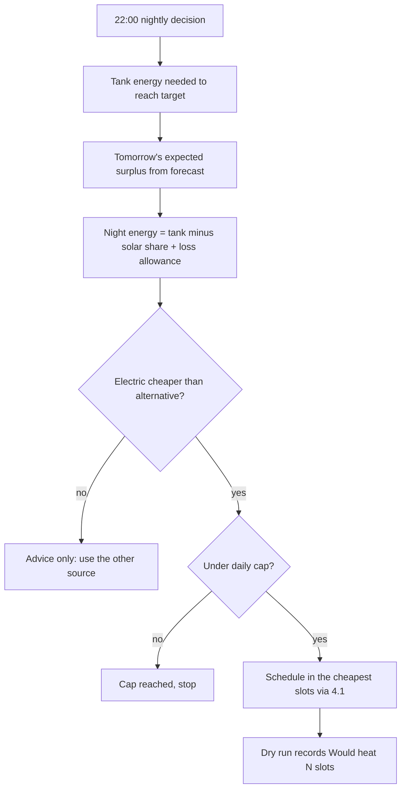

**Worked vector.** 150 litres from 20 to 55 degrees: 150 x 4.186 x 35 / 3600 = **6.10 kWh**. At 3 kW that is 2.03 hours, five half-hours (2.5 h). If tomorrow's expected diversion is 4 kWh: night energy 2.10 kWh = 0.70 hours = **two half-hours**.

**Options.** `immersion_tank_litres` (optional; without it, keep today's behaviour), `immersion_max_kwh_per_day`, `immersion_divert_share`. **Tests.** The vector; cap hit mid-heat; price test both ways; no tank volume leaves behaviour unchanged (golden unchanged).

**Edge cases.** A tank with a thermostat lower than the target. Two elements. A hot-water draw during the day (the temperature sensor handles it).

#### 4.3 C18, C19, C20: surplus arbitration, smoothing and deadline (L)

**Problem.** The battery, the EV and the immersion can each want the same surplus. On and off decisions can flap on cloud edges. A "ready by" deadline should win over waiting for surplus.

**What others do (SPEC-007).** Average the surplus over a window for turn-on decisions, but use the instantaneous value for shedding; require a minimum count of good samples, else take only safety actions; add an on-buffer to a device's rated power and a separate off threshold so it does not start only to stop; allocate in priority order and shed from the lowest; never shed a manually overridden device; a deadline forces a start when the time left is no more than 1.1 times the runtime still owed; battery protection by state of charge.

**Design: a small pure module `core/surplus_budget.py`.**

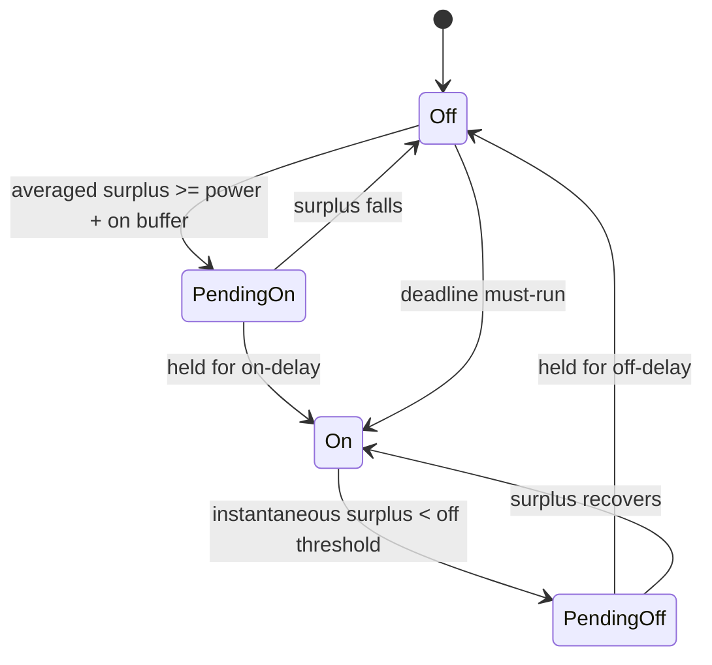

```text
function decide(now, surplus_samples, devices, battery):
    if count_good(surplus_samples) < MIN_GOOD: return safety_only(devices, battery)
    avg = mean(good(surplus_samples)); inst = last_good(surplus_samples)
    budget_avg, budget_inst = avg, inst
    for dev in sorted(devices, by=(priority, id)):                # stable order
        if dev.deadline and time_left(dev) <= 1.1 * runtime_owed(dev): decide ON (bypass delays); continue
        if dev.off and budget_avg >= dev.power + ON_BUFFER and delay_ok(dev): decide ON
        if decided ON: budget_avg -= dev.power; budget_inst -= dev.power
    if budget_inst < OFF_THRESHOLD:
        for dev in sorted(running, by=(-priority)):               # lowest priority first
            if dev.manual or dev.deadline_forced: continue
            decide OFF (after off-delay); budget_inst += dev.power
            if budget_inst >= OFF_THRESHOLD: break
```

**Our devices and the rules that do not change.** The EV is **never stopped or paused** by this, so it is counted as committed load and left to Eco+; only the immersion (and later other switchable loads) is shed. Battery first up to the threshold remains the default.

**A priority mode, our design.** Option `surplus_priority`: `battery_first` (today), `immersion_first`, or `balanced`, where balanced diverts when the battery will fill anyway:

```text
battery_will_fill_anyway = forecast_remaining_kwh * usable_fraction >= battery_space_kwh + expected_load_remaining
allowed = soc >= threshold or (mode == balanced and battery_will_fill_anyway)
```

**Deadline.** The immersion's ready-by already exists; unify it with the must-run rule so a ready-by at 07:00 with 1.5 hours of heating owed starts when 1.65 hours remain, whatever the surplus.

**Constants** (`ON_BUFFER`, `OFF_THRESHOLD`, `MIN_GOOD`, delays) start from the roadmap's C18 smoothing item and are tuned on a real day's data, not copied.

**Tests.** Table-driven cases per state; a cloud-edge sequence that must not flap; shedding order with manual override; deadline beating a low surplus; a missing sensor gives safety-only output. Goldens for the nightly plan do not move.


#### 4.3a C20: periodic pasteurisation cycle (S to M)

**Problem.** A tank kept at a moderate temperature can harbour bacteria. Heat-pump owners in particular top the tank up to a higher temperature on a schedule (one user describes a weekly 3 kW immersion top-up from 50 to 60 degrees). The integration should do this with solar or the cheapest window and never forget it.

**Design.** A small state machine driven by the water temperature sensor. All values are options. **Defaults are placeholders: the temperature, hold time and interval must follow local guidance, and the docs say so.**

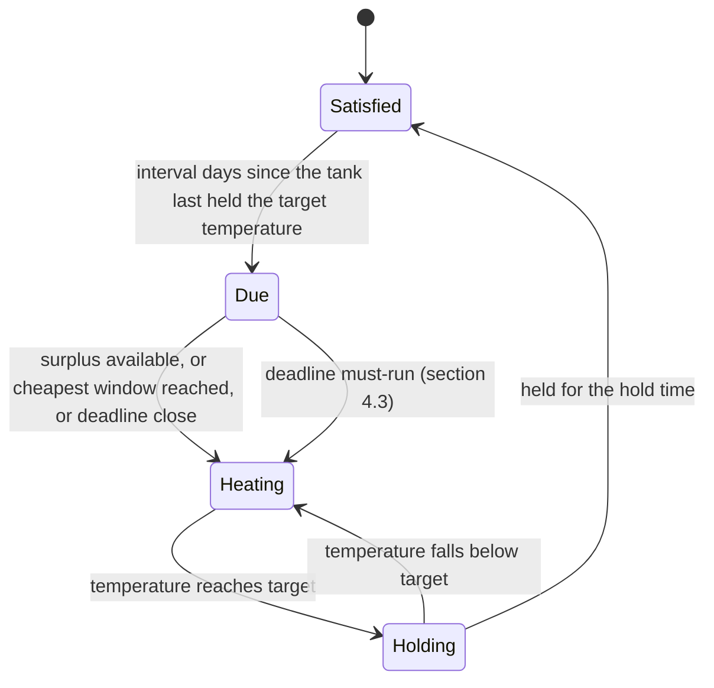

```text
function pasteurisation_state(now, last_satisfied, temp, target, hold_min, interval_days, held_since):
    if now - last_satisfied < interval_days: return SATISFIED
    if temp >= target: held_since = held_since or now
                       return SATISFIED_AND_RESET if now - held_since >= hold_min else HOLDING
    return DUE                       # the planner schedules heating via 4.1 and 4.3
```

**Rules.** Never exceed the existing maximum temperature option. The cycle uses surplus first, then the cheapest slots from 4.1, and becomes a deadline job (4.3) one day before it is overdue. A manual boost that reaches the target also satisfies it. It exempts itself from the daily energy cap (4.2) but is logged in the audit.

**Options.** `pasteurisation_enabled`, `pasteurisation_temp_c`, `pasteurisation_hold_min`, `pasteurisation_interval_days`. **Tests.** Each transition with an injected clock; a sensor that never reaches the target (raises a notice after the deadline); a restart mid-hold.
#### 4.4 N13: EV departure plan (M)

**Problem.** Users want to know when the car will charge to be ready by a time, and the integration cannot stop or force the charger.

**What others do (SPEC-008).** evcc builds the cheapest plan for a required duration by a target time: pick the cheapest slots, trimming the surplus so the first slot starts as late as possible; fall back to charging now if time is short, to a time-only plan if rates are missing, and to part of the plan if the rates end before the target.

**Because we never stop, pause or fast-charge,** the plan is a **signal**: a sensor and a binary sensor for automations and notifications ("plug in before 23:00", "the cheap window covers 22 of 26 kWh"). It does not actuate beyond the existing Eco+ rule.

```mermaid
flowchart TD
  A[Plugged in? energy wanted? departure time] --> B[Required hours = energy / efficiency / power]
  B --> C{Enough time before departure?}
  C -- no --> D[Plan: charge now, continuous]
  C -- yes --> E[select_slots from 4.1 within now..departure, prefer latest]
  E --> F{Rates cover the window?}
  F -- no --> G[Time-only plan]
  F -- yes --> H[Plan slots + cost]
  H --> I[Plan active now? binary sensor]
```

```text
function ev_plan(now, departure, energy_kwh, power_kw, efficiency, bands):
    hours = energy_kwh / efficiency / power_kw
    if departure - now <= hours: return continuous(now, now + hours)
    window = bands clipped to [now, departure]
    if coverage(window) < hours: return time_only(departure - hours, departure)
    slots = select_slots(window, hours, "separate", prefer_latest=True)
    return Plan(slots, cost(slots), active_now = now in any slot)
```

**Vector.** 20 kWh at 7 kW, efficiency 0.9: 20 / 0.9 / 7 = 3.17 h, so **seven** half-hours. With a cheap band 00:00 to 07:00 and departure 07:30, prefer-latest picks 03:30 to 07:00.

**Inputs.** A number entity "EV energy wanted" or a car state-of-charge sensor with battery size; a time entity for departure; the charger's maximum power from discovery. **Shared supply:** the battery also grid-charges in the same window; the supply check (C19) applies.

**Tests.** The vector; not enough time; no tariff; rates end early; plan inactive when unplugged.

#### 4.5 C31: more EV charger brands (M)

**Problem.** Discovery finds five brands but only the Zappi's mode is set.

**Design: capability probing, not a brand table alone.** For each brand discover the mode `select` and its options, then choose the option that means "use surplus only" by a short synonym list; if none matches, do not actuate and say so.

```mermaid
flowchart TD
  A[Charger found] --> B[Read the mode select's options]
  B --> C{Surplus-only option found by synonyms?}
  C -- yes --> D[Use it; never select any stop, off, pause or fast option]
  C -- no --> E{User mapped one in options?}
  E -- yes --> D
  E -- no --> F[Signals only, no actuation]
```

| Brand | Surplus-only option | Source |
|---|---|---|
| Zappi | `Eco+` | in the code |
| GivEnergy charger via GivTCP | `Solar` (the mode select offers Grid, Solar, Hybrid; **never Grid**) | GivTCP datapoints; **check** on a real charger |
| Wallbox, OCPP, Ohme, Easee | unknown | needs an owner's entity list |

```text
function pick_surplus_mode(options):
    forbidden = ["stop", "off", "pause", "fast", "boost", "grid", "max"]
    allowed_synonyms = ["eco+", "solar", "surplus", "green"]
    for opt in options: if lower(opt) contains a forbidden word: continue
                         if lower(opt) is in allowed_synonyms: return opt
    return None
```

**Tests.** Option lists per brand (fixtures), a list containing only forbidden options returns None, the Zappi result is unchanged. **Safety tests:** the forbidden list is checked on every write path.

#### 4.6 N1: charge by carbon intensity (M, needs a decision)

**Problem.** Carbon intensity sensors exist. The plan is cost-led. A fixed tariff gives the same price across a cheap band, so within it the lowest-carbon half-hours could be chosen at no cost.

**Design.** Two steps, the first needing no decision:
1. **Tie-break only.** Within the cheapest band, order equal-price slots by lowest carbon (section 4.1's `select_slots` takes a secondary value).
2. **Monetised carbon (optional).** Option `carbon_price_per_tonne`. Effective price of a slot is `price + carbon_g_per_kwh x carbon_price_per_tonne / 1,000,000`. For example 100 g per kWh at 80 per tonne adds 0.008 per kWh. Zero means cost only.

```text
effective_price(slot, carbon_price_per_tonne):
    return slot.price + slot.carbon_g_per_kwh * carbon_price_per_tonne / 1_000_000
```

**Rules.** Never change the cheap window's start or end outside the tariff's own bands; only choose among slots already inside it. Without a carbon forecast covering the window, use price alone. **Tests.** Equal prices choose the lower carbon; zero carbon price reproduces today; missing carbon data. **Decision needed:** whether to ship step 2 at all.

#### 4.7 S17, N7: appliance cost per use (M)

**Problem.** Users want to know what a dishwasher cycle or a day of an appliance costs. The tariff and the energy are known, but no per-appliance accounting exists.

**What others do.** The Octopus Energy integration tracks the cost of any entity and can compare it with another tariff; PV Excess Control tracks savings per appliance.

**Design.** A cost tracker per chosen energy entity: each increase in energy is multiplied by the price of the band in force at that time and accumulated by day and bill period. Per-use cost needs cycle detection (C2): a cycle starts when power stays above a threshold for a few minutes and ends when it stays below for a few.

```text
on energy increase(entity, delta_kwh, now):
    price = band_price_at(local_time(now))                   # includes VAT, levy, discount as the bill model does
    tracker[entity].today += delta_kwh * price
    if cycle_active(entity): tracker[entity].cycle += delta_kwh * price
on cycle end(entity): notify("{name} used {kwh} for {cost}")
```

**Dependencies.** The device list with roles (S17) and cycle detection (C2). **Tests.** A day spanning two bands, a restart mid-cycle (persist the accumulator), a counter reset at midnight (treat a decrease as a reset).

---

### 5. Interface

#### 5.1 C30: expose a recommended entity set to Assist and LLM tools (S)

**Problem.** Home Assistant does not expose power, energy or battery sensors to voice assistants by default, so "what is my battery at?" returns nothing until each entity is exposed by hand.

**What others do.** givenergy-hass offers an idempotent action that exposes about seventeen headline entities and never un-exposes; it deliberately ships no aliases because the registry cannot tell ours from the user's.

**Design.** A service `expose_recommended_entities` with an optional list of assistants (default the conversation assistant).

```text
RECOMMENDED = [battery_soc, battery_power, solar_power, grid_power, load_power,
               charge_plan_sentence, tonight_target, bill_estimate, immersion_status, night_survival]
function expose(hass, entry, assistants):
    for role in RECOMMENDED:
        entity_id = registry.lookup(entry.unique_id_for(role))     # by unique id, survives renames
        if entity_id is None or entity_disabled: skip and count
        for assistant in assistants: expose_entity(hass, assistant, entity_id, True)   # only ever True
    notify(exposed_count, skipped)
```

**Check** the name and signature of Home Assistant's exposed-entities helper at the floor version (2026.5). **Rules.** Never un-expose. Do not set aliases. Repeat runs change nothing. **Tests.** Idempotent; skips absent roles; a renamed entity is still found by unique id.

#### 5.2 N19: per-module battery health (M)

**Problem.** A pack's health shows in its weakest module, but only one state-of-health estimate is shown.

**What others do.** givenergy-hass makes each module a device with per-cell voltages and temperatures and a heat map card; GivTCP publishes module state of charge, capacity, cycles and temperature, and for high-voltage stacks state of health and cell values.

**Design: compare modules with each other, not with invented limits.** Absolute thresholds would be guesses. Peer comparison needs none.

```text
function module_health(modules):
    for each metric in [soc, temperature, capacity, cycles, cell_spread]:
        values = [m.metric for m in modules if available]
        if len(values) < 2: continue
        med = median(values)
        for m in modules: m.deviation[metric] = (m.metric - med) / max(abs(med), epsilon)
    flag modules whose deviation exceeds FLAG_FRACTION for any metric        # fitted from fixtures
    return summary(count, worst_module, flags, per-module table)
```

**Surface.** One summary sensor with a per-module attribute list; a markdown card in docs. Module names come from GivTCP's entity naming (**fixtures needed**). **Dependencies.** C17 (state of health sensor). **Tests.** Single module (no flags), two modules with one outlier, missing fields.

#### 5.3 N20: Glance and wall-panel views (M)

**Problem.** The dashboard is tabbed and dense. A wall tablet or a quick phone look needs one sentence and three numbers.

**Design.** An entity `status_sentence` (derived in `core/`) plus a dashboard recipe built from core cards: a panel view, a markdown or tile card for the sentence, three large tiles (solar today, battery state of charge, house use today) and a row of small status chips. Dashboards stay user-owned (no auto-creation), so ship it as copy-paste YAML in the docs and in the wizard's dashboard step.

```text
function status_sentence(solar_w, grid_w_signed, batt_w_signed, soc, import_threshold, floor_soc):
    # use the integration's own normalised sensors; signs per the documented convention
    if grid_exporting(grid_w) and solar_w > 0:           "Exporting to the grid"
    elif solar_w >= load and not grid_importing:         "Running on solar"
    elif battery_discharging(batt_w) and not grid_importing: "Running on the battery"
    elif grid_importing and solar_w > 0:                 "Using solar and importing"
    elif grid_importing:                                  "Importing from the grid"
    else:                                                 "Idle"
    colour: green for exporting or self-sufficient; amber for importing or soc < floor_soc
```

**Check** the sign conventions in `CLAUDE.md` before writing the table, because the raw GivTCP signs differ from our normalised sensors. **Tests.** The table, one case per sentence, and a golden for the entity's text states. **Edge cases.** Unavailable sensors (say "Waiting for data"), a zero-power night.

#### 5.4 N14: plan timeline card (M)

**Problem.** The plan is a sentence and a target. Users want to see the night and the day: price, expected solar, expected load and battery level per half-hour.

**What others do.** Predbat's plan card has a row per slot with rates, status, limit, forecast solar, forecast load, car and diverter energy, colour-coded; Energy Conductor shows twelve hours of history and twelve of forecast on one axis.

**Design.** The simulation already produces per-slot values. Publish them as a state attribute on the plan sensor and render with core cards where possible.

```text
plan_slots = [ { start, price, solar_kwh, load_kwh, soc_pct, action } for slot in 48 ]   # action: charge, hold, solar, discharge-to-house
```

**Size limit.** Home Assistant's recorder does not store a state whose attributes exceed a size limit (**check** the current limit). 48 slots of six short fields is well under it; round numbers to two decimals and use short keys.

**Card options.** (1) a markdown card with a template that prints a table (core only); (2) an ApexCharts snippet in the docs for users who have it. Only build a custom card if neither can express it (the roadmap's rule).

**Tests.** 48 entries, DST days (46 or 50), size under the limit, values match the simulation in a golden.

#### 5.5 C17, N8: battery state of health and its trend (M)

**Problem.** There is no state of health figure, and no trend, so a failing module is found late.

**Design: prefer a direct value, then a capacity ratio, and say which was used.**

```text
function state_of_health(modules, rated_cycles_option):
    direct = [m.soh for m in modules if m.soh is a number]            # stack state of health on some systems
    if direct: return mean(direct), "reported"
    ratios = [m.full_capacity / m.design_capacity for m in modules if both are numbers and design > 0]
    if ratios: return min(100, 100 * median(ratios)), "capacity ratio"
    if rated_cycles_option and cycles known: return 100 * (1 - cycles / rated_cycles), "cycle estimate"
    return None
```

Smooth over several days (median of the last seven daily values) so a single odd reading does not move it. Never invent a rated cycle figure; the cycle method only runs when the user supplies one. **Trend (N8):** store the daily value in the history already kept by `accumulation.py`, expose it as an attribute list, and chart it with a core or ApexCharts card. **Check** which GivTCP entities hold module capacities and state of health (fixtures). **Tests.** Each method, fallback order, smoothing, missing fields.

---

### 6. Platform

#### 6.1 N23: a second inverter backend using direct local Modbus (L)

**Problem.** GivTCP needs an add-on and a message broker, and its maintenance after GivEnergy's administration is uncertain. A second backend gives a way to keep working.

**What the candidate offers (givenergy-hass, from its README).** Local Modbus with no cloud, add-on or broker. Hardware detection and topology caching. Controls: enable charge, enable discharge (switches), charge target (number, 4 to 100), battery reserve, charge and discharge rate limits, power mode and pause mode (selects), charge and discharge slots 1 and 2 as time entities. Slots 3 to 10 are deliberately not exposed. **No controls through a Gateway.** An EMS plant reasserts some settings, so writes revert. It reports that two local clients can poll one inverter, and offers an optional passive mode that reads another client's register cache.

**Design.** The backend interface from the 0.19 cards (`InverterBackend`) is the seam. A new adapter implements it; nothing outside `inverter/` changes.

```mermaid
flowchart LR
  C[Coordinator] --> I[InverterBackend interface]
  I --> G[GivTCP adapter, existing]
  I --> L[Local Modbus adapter, new]
  G --> E1[GivTCP entities]
  L --> E2[Direct-Modbus integration entities]
```

**Mapping the concepts the integration uses.**

| Concept | GivTCP adapter | Local adapter (candidate entity names; **check**) |
|---|---|---|
| Battery state of charge | `SOC` | Battery SOC |
| Battery power (positive = discharging) | `Battery_Power` | Battery Power (same sign convention in its README) |
| Grid power (positive = export) | `Grid_Power` | Grid Power (same) |
| Charge target | `Target_SOC` with `Enable_Charge_Target` | Charge Target SOC (**is a separate enable needed? check**) |
| Charge window | `Charge_start_time_slot_1`, `_end_` | Charge Slot 1 Start and End (time entities) |
| Enable charge | `Enable_Charge_Schedule` | Enable Charge |
| Staleness | `Data_Age` | Last Successful Refresh, Consecutive Refresh Failures |

```mermaid
sequenceDiagram
  participant W as Wizard
  participant D as Backend detection
  participant U as User
  W->>D: look for GivTCP entities and for the local integration
  D-->>W: found: GivTCP only / local only / both / neither
  alt both
    W->>U: which one should drive the inverter?
  end
  W->>W: store backend id in the config entry
```

**Risks.** Two integrations on one inverter (the local project says it works, but unverified here). Differences in what a write means (target and enable semantics). The Gateway and EMS limits become the same constraints as in section 1.4. Entity renames between versions of the other integration.

**Tests.** The contract tests written for the interface (card IB7) run against both fakes; a fixture per backend; a write-path test per backend including dry run and read-back.

**Order.** After the interface is merged and system types (1.4) are classified, because the local adapter needs the same controller rules.

#### 6.2 C23: keep working after GivEnergy: backups, migration and fallback (L)

**Problem.** GivEnergy Ltd has gone into administration. The integration is local and keeps working, but users need their data safe and a way forward if GivTCP stops being maintained.

**Design, in three parts.**
1. **Scheduled backup.** The `export_energy_data` action already exists. Add an option `backup_every_days` (0 means off) that runs it on a schedule, writes to a fixed folder in the configuration directory, and keeps the last `backup_keep` files.

```text
every day at 03:00 local:
    if backup_every_days > 0 and days_since_last_backup >= backup_every_days:
        path = run_export(); prune(folder, keep = backup_keep); record(last_backup = now)
```

2. **Migration guide in the docs.** What to keep (energy history, tariff settings, learned load profile), what restarts (the plan, the accuracy history), and how to move to another inverter brand by writing a backend (section 6.1).
3. **Fallback.** If GivTCP is unavailable, the integration already detects it. Extend the notice to say what still works (read-only history, the bill estimate) and link to the second-backend work when it exists.

**Tests.** Retention keeps exactly N files, a failed export does not prune, a skipped day, an unwritable folder (repair). **Order.** The backup first; it is small and independent.

---

### 7. Suggested order of delivery

```mermaid
flowchart LR
  R1[0.19 as briefed: backend interface, retry and re-plan, seasons, forecast shape, system discovery, GivEnergy EV charger] --> R2
  R2[Next: S19 profile export, C29, C32, C28, C25, C34, C30] --> R3
  R3[Then: N12 verified, C33, S5, S4 and N4, N13] --> R4
  R4[Later: arbitration, N22, N21, N19, N20, N14, N24, N23]
```

| Group | Why this order |
|---|---|
| Next | Small, independent, mostly diagnostics or one new input. S19 unlocks fixtures for everything about system types. C25 moves goldens, so do it alone |
| Then | Needs a spike or fixtures first (forecast routes, EV plan inputs), and reuses the window helper |
| Later | Larger write paths (N22), research (N24), or a new platform of work (N23) |

### 8. Open questions gathered

| Where | Question | Who answers |
|---|---|---|
| 1.2 | Exact name and default of Solcast's P10 attribute option | Spike FS1 |
| 1.3 | Which capacity value matches usable energy on each system type | Fixtures |
| 1.4 | The exact `Invertor_Type` strings (it is a sensor in 3.6); which entity to write on a parallel All-in-One system | U9, U10 |
| 2.1 | Which of the three forecast routes works on a live instance, and the per-period units | Spike FS1 |
| 2.3 | Whether a daily-level correction beats the existing scaling | Backtest |
| 3.1 | Default away fraction | Real histories |
| 3.2 | Real charge and discharge efficiency | Measured data |
| 3.4 | Entity names for charge slot 2 and per-slot targets | Fixtures, U8 |
| 3.5 | Which alert feeds are trustworthy per country | Read Predbat's design, then test |
| 4.2 | Divert share and standing-loss model | Real tank data |
| 4.3 | Smoothing constants | A real day's data |
| 4.4 | How the user supplies the energy wanted | Maintainer decision |
| 4.5 | Mode names for Wallbox, OCPP, Ohme, Easee | Owners' entity lists |
| 5.2 | Module entity names and the flag fraction | Fixtures |
| 5.4 | The attribute size limit | Check the Home Assistant source |
| 6.1 | Target and enable semantics on the local backend | Specification SPEC-011 and 020 |

### 9. Source pointers

- Detailed behaviours extracted from other projects: Part C (specifications) (SPEC-001) and Part C (SPEC-003 load history and away mode, SPEC-004 diverter, SPEC-005 hardware detection, SPEC-006 cheapest windows, SPEC-007 surplus allocation, SPEC-008 departure plan, SPEC-009 condition-matched correction).
- The gap analysis with links: Part D (gap analysis).
- Roadmap wording and ids: Appendix F of `Part A`.


---
